# Scitizia: 39 low-poly wheels and 36 tires in glTF/GLB with a retro 64-bit look

🇬🇧 English · **🇧🇷 [Leia em português](README.md)**

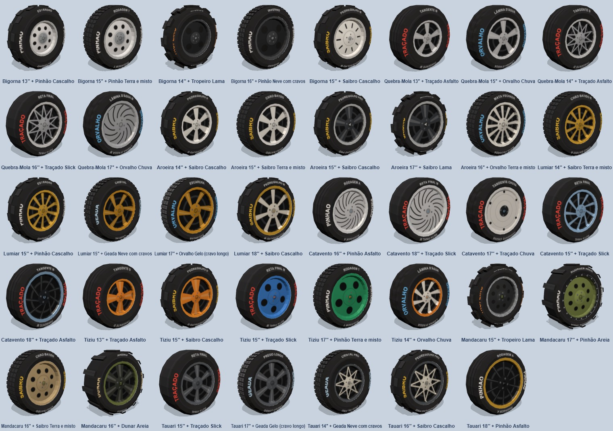

https://github.com/user-attachments/assets/a73b689d-2dd8-4370-ba1c-fab00e3bda2e

▶️ **[Watch the video on YouTube](https://www.youtube.com/watch?v=1N9vVgjuItI)** · **[Download on itch.io](https://kkyqr.itch.io/scitizia-wheels-64)** (free, optional donation)

**Scitizia: 64-bit wheels and tires** is a free collection of low-poly car wheels and tires with the retro look of 64-bit consoles, ready for real-time racing games: **39 wheels** from 8 made-up brands (13 to 18-inch rims; steel, alloy, forged and magnesium), **36 tires** (29 lines from 7 made-up brands and 7 stock tires) in 9 types, from slick to long-stud ice, and **39 assembled wheel and tire sets**, each with a right-side version. That makes 153 binary glTF 2.0 files (`.glb`) of 46.9 to 192.3 KB, with 336 to 1,872 triangles, pivot at the hub center and spin on the X axis, and PNG textures painted by code (the rim design, the sidewall lettering and the tread) with "nearest" filtering. The wheels and tires are the same ones from the game **Scitizia Rally Championship**; brands, names and logos are made up, with no real brand.

## Summary

| | |
|---|---|
| Models | 153: 39 wheels on their own, 36 tires on their own and 39 assembled sets (× 2 sides) |
| Format | binary glTF 2.0 (`.glb`), textures also as PNG |
| Triangles | wheels 432, tires 336 to 1,776, sets 432 to 1,872 |
| Size | 46.9 to 192.3 KB per file, with the textures embedded |
| Wheels | 8 brands, 13, 14, 15, 16, 17, 18-inch rims; steel, cast alloy, forged and forged magnesium |
| Tires | 9 types: tarmac, slick, wet, gravel, dirt and mixed, mud, studded snow, ice (long studs), sand; soft, medium or hard rubber; 15-inch rim |
| Reference size | tire 660 mm in diameter and 215 mm wide; each type changes the height and width a little |
| Textures | rim 256×256 px and tire 512×256 px (sidewall, tread and block face), "nearest" filtering on magnification |
| Scale and axes | meters, Y up, spin around X, pivot at the hub center, outer face toward +X |
| Machine-readable catalog | [`catalogo.json`](catalogo.json) |
| License | public domain, [CC0 1.0](LICENSE) |

## Assembled sets

Wheel and tire in a single file, ready to put on the car: one mesh with two materials (`Pneu` and `Aro`), exactly as in the game. Each wheel got a tire that matches its brand, and all 9 tire types appear. `<id>.glb` is the left side (face toward +X) and `<id>_direita.glb` the right side (mirrored, face toward −X, with legible lettering and the directional tread running in the same direction). 39 sets.

| Preview | Set | Triangles | Size |
|---|---|---|---|
| 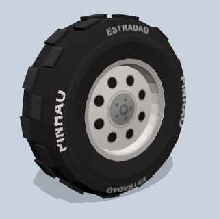 | **Bigorna Estampada 13″ + Pinhão Estradão**<br>Gravel<br>`bigorna_estampada_13_com_pinhao_estradao`<br>[right](modelos/conjuntos/bigorna_estampada_13_com_pinhao_estradao_direita.glb) | 672 | 96.5 KB |
| 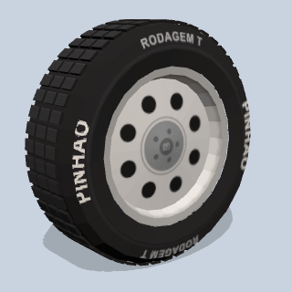 | **Bigorna Estampada 15″ + Pinhão Rodagem T**<br>Dirt and mixed<br>`bigorna_estampada_15_com_pinhao_rodagem_t`<br>[right](modelos/conjuntos/bigorna_estampada_15_com_pinhao_rodagem_t_direita.glb) | 1,872 | 178.8 KB |
| 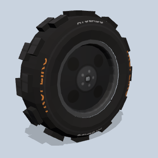 | **Bigorna Reforçada de Rali 14″ + Tropeiro Atolado**<br>Mud<br>`bigorna_reforcada_14_com_tropeiro_atolado`<br>[right](modelos/conjuntos/bigorna_reforcada_14_com_tropeiro_atolado_direita.glb) | 672 | 95.0 KB |
| 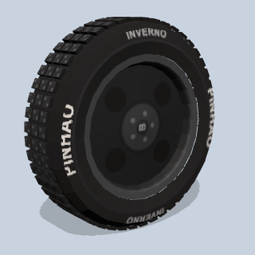 | **Bigorna Reforçada de Rali 16″ + Pinhão Inverno**<br>Studded snow<br>`bigorna_reforcada_16_com_pinhao_inverno`<br>[right](modelos/conjuntos/bigorna_reforcada_16_com_pinhao_inverno_direita.glb) | 1,872 | 175.9 KB |
| 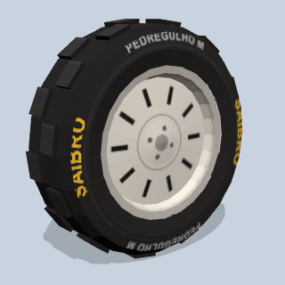 | **Bigorna Ventilada Branca 15″ + Saibro Pedregulho M**<br>Gravel<br>`bigorna_ventilada_15_com_saibro_pedregulho_m`<br>[right](modelos/conjuntos/bigorna_ventilada_15_com_saibro_pedregulho_m_direita.glb) | 672 | 96.7 KB |
| 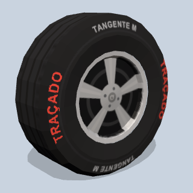 | **Quebra-Mola Estrela 13″ + Traçado Tangente M**<br>Tarmac<br>`quebramola_estrela_13_com_tracado_tangente_m`<br>[right](modelos/conjuntos/quebramola_estrela_13_com_tracado_tangente_m_direita.glb) | 432 | 88.4 KB |
| 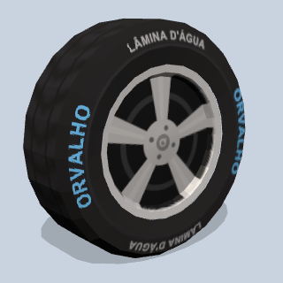 | **Quebra-Mola Estrela 15″ + Orvalho Lâmina d'Água**<br>Wet<br>`quebramola_estrela_15_com_orvalho_lamina`<br>[right](modelos/conjuntos/quebramola_estrela_15_com_orvalho_lamina_direita.glb) | 432 | 92.1 KB |
| 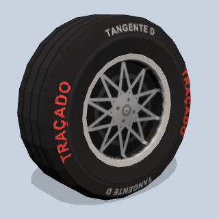 | **Quebra-Mola Malha 14″ + Traçado Tangente D**<br>Tarmac<br>`quebramola_malha_14_com_tracado_tangente_d`<br>[right](modelos/conjuntos/quebramola_malha_14_com_tracado_tangente_d_direita.glb) | 432 | 95.3 KB |
| 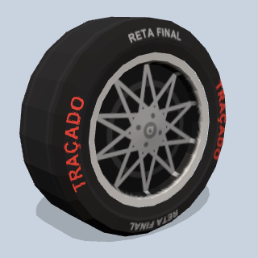 | **Quebra-Mola Malha 16″ + Traçado Reta Final**<br>Slick<br>`quebramola_malha_16_com_tracado_reta_final`<br>[right](modelos/conjuntos/quebramola_malha_16_com_tracado_reta_final_direita.glb) | 432 | 93.4 KB |
| 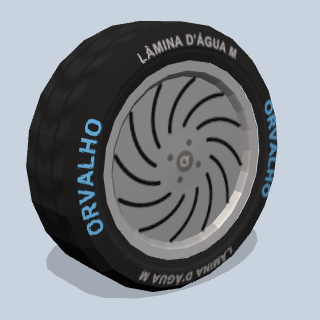 | **Quebra-Mola Turbina 17″ + Orvalho Lâmina d'Água M**<br>Wet<br>`quebramola_turbina_17_com_orvalho_lamina_m`<br>[right](modelos/conjuntos/quebramola_turbina_17_com_orvalho_lamina_m_direita.glb) | 432 | 88.6 KB |
| 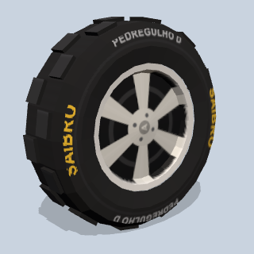 | **Aroeira Seis Raios 14″ + Saibro Pedregulho D**<br>Gravel<br>`aroeira_seis_14_com_saibro_pedregulho_d`<br>[right](modelos/conjuntos/aroeira_seis_14_com_saibro_pedregulho_d_direita.glb) | 672 | 101.5 KB |
| 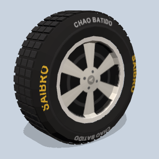 | **Aroeira Seis Raios 15″ + Saibro Chão Batido**<br>Dirt and mixed<br>`aroeira_seis_15_com_saibro_chao_batido`<br>[right](modelos/conjuntos/aroeira_seis_15_com_saibro_chao_batido_direita.glb) | 1,872 | 182.6 KB |
| 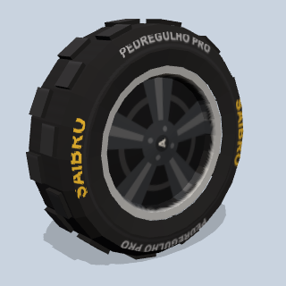 | **Aroeira Cinco Largos 15″ + Saibro Pedregulho Pro**<br>Gravel<br>`aroeira_cinco_15_com_saibro_pedregulho_pro`<br>[right](modelos/conjuntos/aroeira_cinco_15_com_saibro_pedregulho_pro_direita.glb) | 672 | 103.8 KB |
| 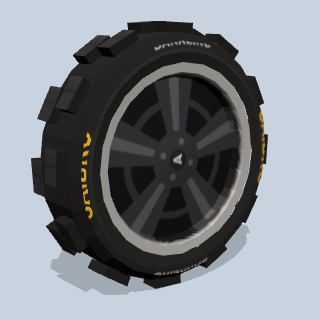 | **Aroeira Cinco Largos 17″ + Saibro Barreiro**<br>Mud<br>`aroeira_cinco_17_com_saibro_barreiro`<br>[right](modelos/conjuntos/aroeira_cinco_17_com_saibro_barreiro_direita.glb) | 672 | 100.8 KB |
| 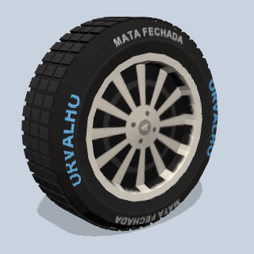 | **Aroeira Doze Raios 16″ + Orvalho Mata Fechada**<br>Dirt and mixed<br>`aroeira_doze_16_com_orvalho_mata_fechada`<br>[right](modelos/conjuntos/aroeira_doze_16_com_orvalho_mata_fechada_direita.glb) | 1,872 | 192.3 KB |
| 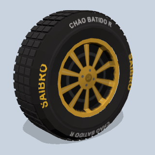 | **Lumiar Dez Raios 14″ + Saibro Chão Batido R**<br>Dirt and mixed<br>`lumiar_dez_14_com_saibro_chao_batido_r`<br>[right](modelos/conjuntos/lumiar_dez_14_com_saibro_chao_batido_r_direita.glb) | 1,872 | 189.5 KB |
| 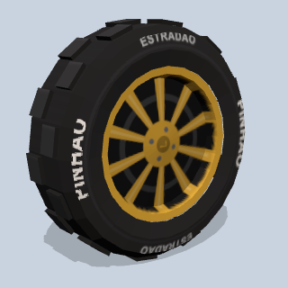 | **Lumiar Dez Raios 15″ + Pinhão Estradão**<br>Gravel<br>`lumiar_dez_15_com_pinhao_estradao`<br>[right](modelos/conjuntos/lumiar_dez_15_com_pinhao_estradao_direita.glb) | 672 | 105.7 KB |
| 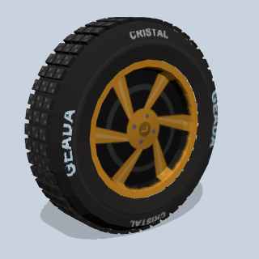 | **Lumiar Lâmina 15″ + Geada Cristal**<br>Studded snow<br>`lumiar_lamina_15_com_geada_cristal`<br>[right](modelos/conjuntos/lumiar_lamina_15_com_geada_cristal_direita.glb) | 1,872 | 184.1 KB |
| 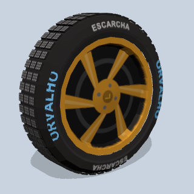 | **Lumiar Lâmina 17″ + Orvalho Escarcha**<br>Ice (long studs)<br>`lumiar_lamina_17_com_orvalho_escarcha`<br>[right](modelos/conjuntos/lumiar_lamina_17_com_orvalho_escarcha_direita.glb) | 1,872 | 189.6 KB |
| 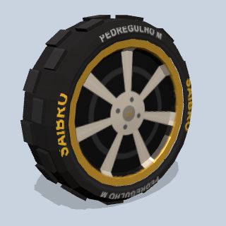 | **Lumiar Estrela Forjada 18″ + Saibro Pedregulho M**<br>Gravel<br>`lumiar_estrela_18_com_saibro_pedregulho_m`<br>[right](modelos/conjuntos/lumiar_estrela_18_com_saibro_pedregulho_m_direita.glb) | 672 | 106.3 KB |
| 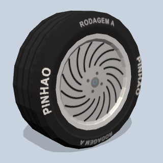 | **Catavento Hélice 16″ + Pinhão Rodagem A**<br>Tarmac<br>`catavento_helice_16_com_pinhao_rodagem_a`<br>[right](modelos/conjuntos/catavento_helice_16_com_pinhao_rodagem_a_direita.glb) | 432 | 85.1 KB |
| 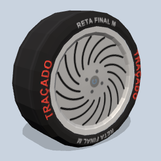 | **Catavento Hélice 18″ + Traçado Reta Final M**<br>Slick<br>`catavento_helice_18_com_tracado_reta_final_m`<br>[right](modelos/conjuntos/catavento_helice_18_com_tracado_reta_final_m_direita.glb) | 432 | 85.2 KB |
| 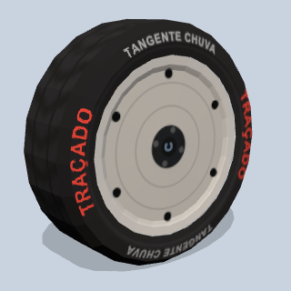 | **Catavento Disco Aero 17″ + Traçado Tangente Chuva**<br>Wet<br>`catavento_disco_17_com_tracado_tangente_chuva`<br>[right](modelos/conjuntos/catavento_disco_17_com_tracado_tangente_chuva_direita.glb) | 432 | 90.3 KB |
| 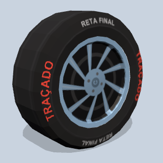 | **Catavento Pás Curvas 15″ + Traçado Reta Final**<br>Slick<br>`catavento_pas_15_com_tracado_reta_final`<br>[right](modelos/conjuntos/catavento_pas_15_com_tracado_reta_final_direita.glb) | 432 | 92.8 KB |
| 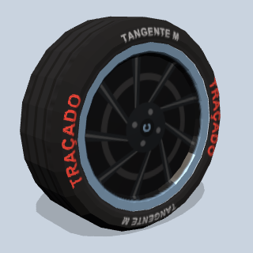 | **Catavento Pás Curvas 18″ + Traçado Tangente M**<br>Tarmac<br>`catavento_pas_18_com_tracado_tangente_m`<br>[right](modelos/conjuntos/catavento_pas_18_com_tracado_tangente_m_direita.glb) | 432 | 93.3 KB |
| 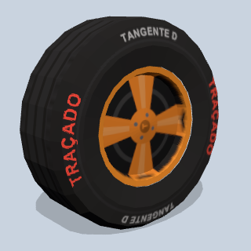 | **Tiziu Cruzeta 13″ + Traçado Tangente D**<br>Tarmac<br>`tiziu_cruzeta_13_com_tracado_tangente_d`<br>[right](modelos/conjuntos/tiziu_cruzeta_13_com_tracado_tangente_d_direita.glb) | 432 | 83.5 KB |
| 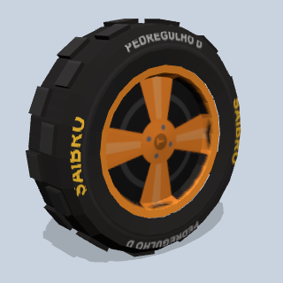 | **Tiziu Cruzeta 15″ + Saibro Pedregulho D**<br>Gravel<br>`tiziu_cruzeta_15_com_saibro_pedregulho_d`<br>[right](modelos/conjuntos/tiziu_cruzeta_15_com_saibro_pedregulho_d_direita.glb) | 672 | 98.6 KB |
| 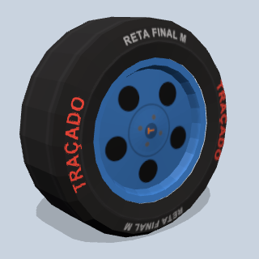 | **Tiziu Cinco Vazados 15″ + Traçado Reta Final M**<br>Slick<br>`tiziu_vazada_15_com_tracado_reta_final_m`<br>[right](modelos/conjuntos/tiziu_vazada_15_com_tracado_reta_final_m_direita.glb) | 432 | 81.4 KB |
| 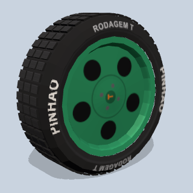 | **Tiziu Cinco Vazados 17″ + Pinhão Rodagem T**<br>Dirt and mixed<br>`tiziu_vazada_17_com_pinhao_rodagem_t`<br>[right](modelos/conjuntos/tiziu_vazada_17_com_pinhao_rodagem_t_direita.glb) | 1,872 | 177.5 KB |
| 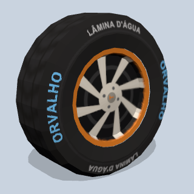 | **Tiziu Leque 14″ + Orvalho Lâmina d'Água**<br>Wet<br>`tiziu_leque_14_com_orvalho_lamina`<br>[right](modelos/conjuntos/tiziu_leque_14_com_orvalho_lamina_direita.glb) | 432 | 94.5 KB |
|  | **Mandacaru Trava de Talão 15″ + Tropeiro Atolado Pro**<br>Mud<br>`mandacaru_trava_15_com_tropeiro_atolado_pro`<br>[right](modelos/conjuntos/mandacaru_trava_15_com_tropeiro_atolado_pro_direita.glb) | 672 | 97.5 KB |
| 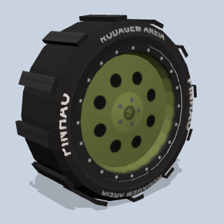 | **Mandacaru Trava de Talão 17″ + Pinhão Rodagem Areia**<br>Sand<br>`mandacaru_trava_17_com_pinhao_rodagem_areia`<br>[right](modelos/conjuntos/mandacaru_trava_17_com_pinhao_rodagem_areia_direita.glb) | 552 | 89.5 KB |
| 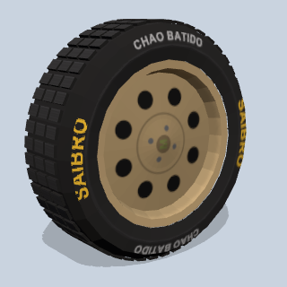 | **Mandacaru Sertão Oito Furos 16″ + Saibro Chão Batido**<br>Dirt and mixed<br>`mandacaru_sertao_16_com_saibro_chao_batido`<br>[right](modelos/conjuntos/mandacaru_sertao_16_com_saibro_chao_batido_direita.glb) | 1,872 | 178.7 KB |
| 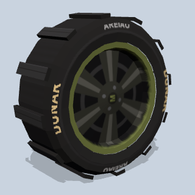 | **Mandacaru Lajedo 16″ + Dunar Areião**<br>Sand<br>`mandacaru_lajedo_16_com_dunar_areiao`<br>[right](modelos/conjuntos/mandacaru_lajedo_16_com_dunar_areiao_direita.glb) | 552 | 89.5 KB |
| 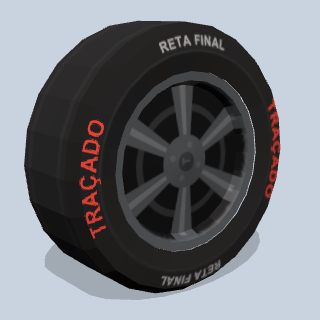 | **Tauari Magnésio Seis 15″ + Traçado Reta Final**<br>Slick<br>`tauari_magnesio_15_com_tracado_reta_final`<br>[right](modelos/conjuntos/tauari_magnesio_15_com_tracado_reta_final_direita.glb) | 432 | 84.5 KB |
| 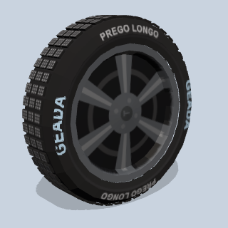 | **Tauari Magnésio Seis 17″ + Geada Prego Longo**<br>Ice (long studs)<br>`tauari_magnesio_17_com_geada_prego_longo`<br>[right](modelos/conjuntos/tauari_magnesio_17_com_geada_prego_longo_direita.glb) | 1,872 | 186.1 KB |
| 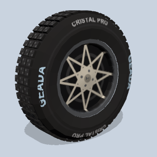 | **Tauari Malha de Magnésio 14″ + Geada Cristal Pro**<br>Studded snow<br>`tauari_malha_14_com_geada_cristal_pro`<br>[right](modelos/conjuntos/tauari_malha_14_com_geada_cristal_pro_direita.glb) | 1,872 | 190.1 KB |
| 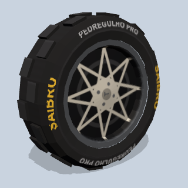 | **Tauari Malha de Magnésio 16″ + Saibro Pedregulho Pro**<br>Gravel<br>`tauari_malha_16_com_saibro_pedregulho_pro`<br>[right](modelos/conjuntos/tauari_malha_16_com_saibro_pedregulho_pro_direita.glb) | 672 | 109.8 KB |
| 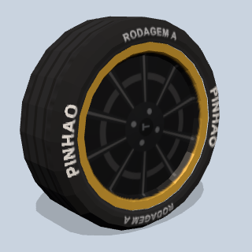 | **Tauari Monobloco Dez 18″ + Pinhão Rodagem A**<br>Tarmac<br>`tauari_monobloco_18_com_pinhao_rodagem_a`<br>[right](modelos/conjuntos/tauari_monobloco_18_com_pinhao_rodagem_a_direita.glb) | 432 | 90.5 KB |

## Wheels

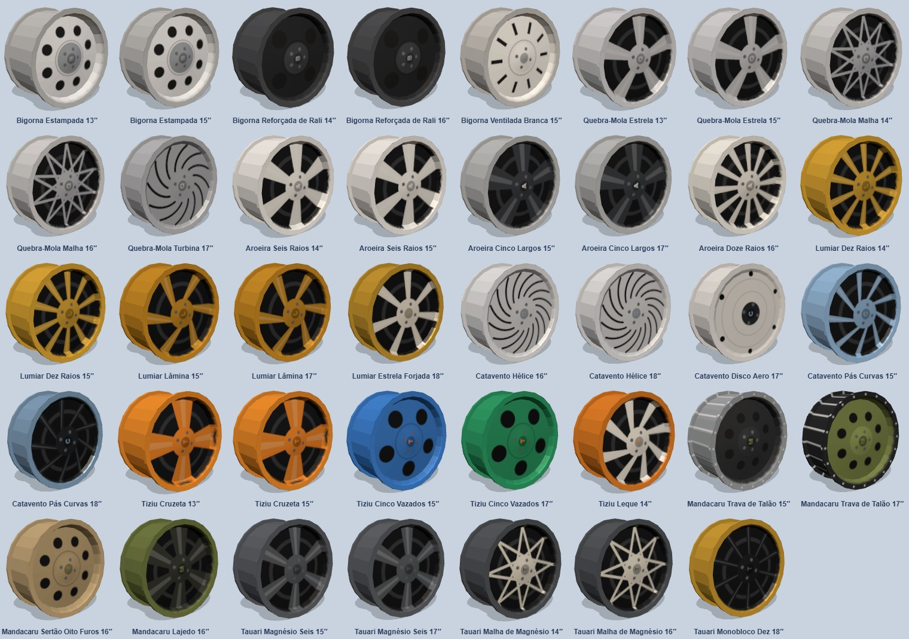

Each wheel (rim) comes on its own, with the drawn face (spokes, holes, mesh, propeller, disc or beadlock), the lip, the barrel and the back closed: it works for showcases, workshop stock or to assemble with another tire. Those that exist in more than one rim size come once per size. 39 wheels.

### Bigorna

Pressed steel that bends and does not break: the wheel of grassroots rally. 5 wheels.

| Preview | Wheel | Rim | Material | Design | Weight | Triangles | Size |
|---|---|---|---|---|---|---|---|
| 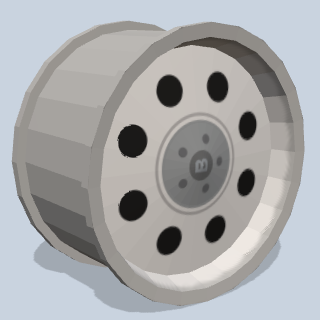 | **Bigorna Estampada**<br>`bigorna_estampada_13` | 13″ | Steel | pressed with holes | 6.7 kg | 432 | 49.3 KB |
| 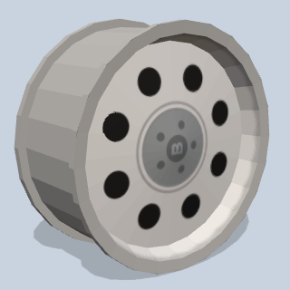 | **Bigorna Estampada**<br>`bigorna_estampada_15` | 15″ | Steel | pressed with holes | 8.2 kg | 432 | 49.3 KB |
| 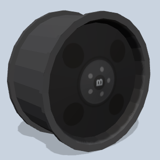 | **Bigorna Reforçada de Rali**<br>`bigorna_reforcada_14` | 14″ | Steel | pressed with holes | 7.5 kg | 432 | 46.9 KB |
| 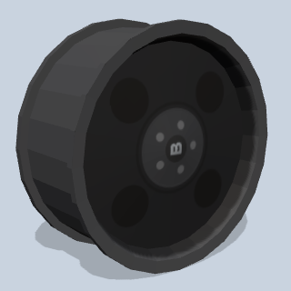 | **Bigorna Reforçada de Rali**<br>`bigorna_reforcada_16` | 16″ | Steel | pressed with holes | 9.0 kg | 432 | 46.9 KB |
| 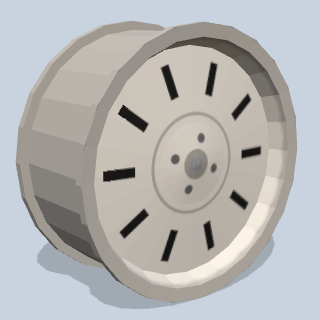 | **Bigorna Ventilada Branca**<br>`bigorna_ventilada_15` | 15″ | Steel | pressed with slots | 8.2 kg | 432 | 47.5 KB |

### Quebra-Mola

Popular street alloy, cheap and good-looking in the parking lot. 5 wheels.

| Preview | Wheel | Rim | Material | Design | Weight | Triangles | Size |
|---|---|---|---|---|---|---|---|
| 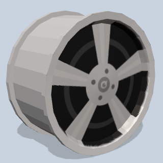 | **Quebra-Mola Estrela**<br>`quebramola_estrela_13` | 13″ | Cast alloy | spokes (5) | 5.6 kg | 432 | 54.2 KB |
| 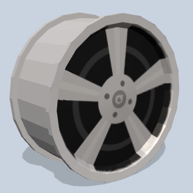 | **Quebra-Mola Estrela**<br>`quebramola_estrela_15` | 15″ | Cast alloy | spokes (5) | 6.9 kg | 432 | 54.2 KB |
| 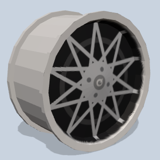 | **Quebra-Mola Malha**<br>`quebramola_malha_14` | 14″ | Cast alloy | cross mesh (10) | 6.3 kg | 432 | 61.3 KB |
| 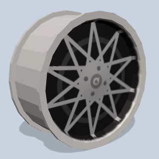 | **Quebra-Mola Malha**<br>`quebramola_malha_16` | 16″ | Cast alloy | cross mesh (10) | 7.6 kg | 432 | 61.3 KB |
| 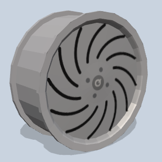 | **Quebra-Mola Turbina**<br>`quebramola_turbina_17` | 17″ | Cast alloy | propeller (12) | 8.2 kg | 432 | 49.9 KB |

### Aroeira

Cast alloy for rally: thick spokes, handles rocks and curbs. 5 wheels.

| Preview | Wheel | Rim | Material | Design | Weight | Triangles | Size |
|---|---|---|---|---|---|---|---|
|  | **Aroeira Seis Raios**<br>`aroeira_seis_14` | 14″ | Cast alloy | spokes (6) | 6.3 kg | 432 | 52.4 KB |
|  | **Aroeira Seis Raios**<br>`aroeira_seis_15` | 15″ | Cast alloy | spokes (6) | 6.9 kg | 432 | 52.4 KB |
|  | **Aroeira Cinco Largos**<br>`aroeira_cinco_15` | 15″ | Cast alloy | spokes (5) | 6.9 kg | 432 | 53.7 KB |
|  | **Aroeira Cinco Largos**<br>`aroeira_cinco_17` | 17″ | Cast alloy | spokes (5) | 8.2 kg | 432 | 53.7 KB |
|  | **Aroeira Doze Raios**<br>`aroeira_doze_16` | 16″ | Cast alloy | spokes (12) | 7.6 kg | 432 | 60.0 KB |

### Lumiar

Light forged wheels with the gold of the dirt specials. 5 wheels.

| Preview | Wheel | Rim | Material | Design | Weight | Triangles | Size |
|---|---|---|---|---|---|---|---|
|  | **Lumiar Dez Raios**<br>`lumiar_dez_14` | 14″ | Forged | spokes (10) | 5.1 kg | 432 | 58.5 KB |
|  | **Lumiar Dez Raios**<br>`lumiar_dez_15` | 15″ | Forged | spokes (10) | 5.6 kg | 432 | 58.5 KB |
|  | **Lumiar Lâmina**<br>`lumiar_lamina_15` | 15″ | Forged | curved blades (6) | 5.6 kg | 432 | 55.6 KB |
|  | **Lumiar Lâmina**<br>`lumiar_lamina_17` | 17″ | Forged | curved blades (6) | 6.7 kg | 432 | 55.6 KB |
|  | **Lumiar Estrela Forjada**<br>`lumiar_estrela_18` | 18″ | Forged | spokes (7) | 7.3 kg | 432 | 57.1 KB |

### Catavento

Large rims and turbine design for fast tarmac. 5 wheels.

| Preview | Wheel | Rim | Material | Design | Weight | Triangles | Size |
|---|---|---|---|---|---|---|---|
|  | **Catavento Hélice**<br>`catavento_helice_16` | 16″ | Cast alloy | propeller (16) | 7.6 kg | 432 | 52.5 KB |
|  | **Catavento Hélice**<br>`catavento_helice_18` | 18″ | Cast alloy | propeller (16) | 8.9 kg | 432 | 52.8 KB |
|  | **Catavento Disco Aero**<br>`catavento_disco_17` | 17″ | Forged | closed disc | 6.7 kg | 432 | 51.6 KB |
|  | **Catavento Pás Curvas**<br>`catavento_pas_15` | 15″ | Cast alloy | curved blades (9) | 6.9 kg | 432 | 60.6 KB |
|  | **Catavento Pás Curvas**<br>`catavento_pas_18` | 18″ | Forged | curved blades (9) | 7.3 kg | 432 | 59.1 KB |

### Tiziu

Open spokes and bird colors: the face of kit cars. 5 wheels.

| Preview | Wheel | Rim | Material | Design | Weight | Triangles | Size |
|---|---|---|---|---|---|---|---|
|  | **Tiziu Cruzeta**<br>`tiziu_cruzeta_13` | 13″ | Cast alloy | spokes (4) | 5.6 kg | 432 | 49.5 KB |
|  | **Tiziu Cruzeta**<br>`tiziu_cruzeta_15` | 15″ | Cast alloy | spokes (4) | 6.9 kg | 432 | 49.5 KB |
|  | **Tiziu Cinco Vazados**<br>`tiziu_vazada_15` | 15″ | Cast alloy | pressed with holes | 6.9 kg | 432 | 48.7 KB |
|  | **Tiziu Cinco Vazados**<br>`tiziu_vazada_17` | 17″ | Forged | pressed with holes | 6.7 kg | 432 | 48.0 KB |
|  | **Tiziu Leque**<br>`tiziu_leque_14` | 14″ | Cast alloy | curved blades (8) | 6.3 kg | 432 | 56.6 KB |

### Mandacaru

Beadlock and reinforced alloy for those who drive off the road. 4 wheels.

| Preview | Wheel | Rim | Material | Design | Weight | Triangles | Size |
|---|---|---|---|---|---|---|---|
|  | **Mandacaru Trava de Talão**<br>`mandacaru_trava_15` | 15″ | Steel | beadlock | 8.2 kg | 432 | 47.7 KB |
|  | **Mandacaru Trava de Talão**<br>`mandacaru_trava_17` | 17″ | Cast alloy | beadlock | 8.2 kg | 432 | 48.6 KB |
|  | **Mandacaru Sertão Oito Furos**<br>`mandacaru_sertao_16` | 16″ | Cast alloy | pressed with holes | 7.6 kg | 432 | 48.5 KB |
|  | **Mandacaru Lajedo**<br>`mandacaru_lajedo_16` | 16″ | Forged | spokes (6) | 6.1 kg | 432 | 52.5 KB |

### Tauari

Forged magnesium for competition: the lightest wheel in the park. 5 wheels.

| Preview | Wheel | Rim | Material | Design | Weight | Triangles | Size |
|---|---|---|---|---|---|---|---|
|  | **Tauari Magnésio Seis**<br>`tauari_magnesio_15` | 15″ | Forged magnesium | spokes (6) | 4.7 kg | 432 | 52.3 KB |
|  | **Tauari Magnésio Seis**<br>`tauari_magnesio_17` | 17″ | Forged magnesium | spokes (6) | 5.7 kg | 432 | 52.3 KB |
|  | **Tauari Malha de Magnésio**<br>`tauari_malha_14` | 14″ | Forged magnesium | cross mesh (8) | 4.2 kg | 432 | 59.7 KB |
|  | **Tauari Malha de Magnésio**<br>`tauari_malha_16` | 16″ | Forged magnesium | cross mesh (8) | 5.2 kg | 432 | 59.7 KB |
|  | **Tauari Monobloco Dez**<br>`tauari_monobloco_18` | 18″ | Forged magnesium | spokes (10) | 6.1 kg | 432 | 57.9 KB |

## Tires


Each tire comes on its own, on the 15-inch rim, with outer and inner sidewall, bead and the tread of its type: the lugs, blocks and paddles are real relief in the mesh; grooves, sipes and studs are in the texture. The brand and line name is written on the sidewall. 36 tires: 29 brand lines and 7 stock (lettering "RALI").

### Tire types

Where each type performs best or worst, compared with a stock mixed tire (this is what the game uses in the physics; the brand lines and the rubber only improve or worsen a little within the type):

| Type | Tread | Where to use |
|---|---|---|
| Tarmac | Longitudinal grooves | Best on tarmac, dirty tarmac and wooden bridge; weak on mud, snow, ice and sand. |
| Slick | Smooth (slick) | Best on tarmac; average on dirty tarmac and wooden bridge; weak on gravel, dirt, grass, mud, snow, ice, sand and shallow water; very weak in the rain. |
| Wet | Arrow-shaped grooves | Best on tarmac, dirty tarmac and wooden bridge; average on gravel, dirt and grass; clears water and grips well in the rain. |
| Gravel | Alternating blocks | Best on gravel, dirt and grass; average on dirty tarmac, wooden bridge, mud, ice, sand and shallow water; copes with rain. |
| Dirt and mixed | Small blocks with sipes | Best on dirt, gravel, grass and mud; average on tarmac, dirty tarmac, wooden bridge, snow, ice, sand and shallow water; copes with rain. |
| Mud | Tall V-shaped lugs | Best on mud, shallow water, grass and dirt; average on gravel and snow; weak on tarmac; copes with rain. |
| Studded snow | Blocks with sipes | Best on ice and snow; average on dirt; weak on tarmac and dirty tarmac. |
| Ice (long studs) | Blocks with sipes | Best on ice and snow; weak on tarmac, dirty tarmac and wooden bridge. |
| Sand | Transverse paddles | Best on sand and gravel; average on dirty tarmac, wooden bridge, dirt, grass, mud, snow, ice and shallow water. |

### Saibro

Born on the dirt roads of the countryside and thinks only of gravel. 6 tires.

| Preview | Tire | Type | Rubber | Dimensions | Use by surface | Triangles | Size |
|---|---|---|---|---|---|---|---|
|  | **Saibro Pedregulho M**<br>`saibro_pedregulho_m` | Gravel<br>alternating blocks | soft | 206 mm × 667 mm, 15-inch rim | Best on gravel, dirt and grass (rest in the tire types table). | 576 | 68.7 KB |
|  | **Saibro Pedregulho D**<br>`saibro_pedregulho_d` | Gravel<br>alternating blocks | hard | 206 mm × 667 mm, 15-inch rim | Best on gravel, dirt and grass (rest in the tire types table). | 576 | 68.6 KB |
|  | **Saibro Pedregulho Pro**<br>`saibro_pedregulho_pro` | Gravel<br>alternating blocks | soft | 206 mm × 667 mm, 15-inch rim | Best on gravel, dirt and grass (rest in the tire types table). | 576 | 69.5 KB |
|  | **Saibro Chão Batido**<br>`saibro_chao_batido` | Dirt and mixed<br>small blocks with sipes | medium | 215 mm × 660 mm, 15-inch rim | Best on dirt, gravel, grass and mud (rest in the tire types table). | 1,776 | 149.7 KB |
|  | **Saibro Chão Batido R**<br>`saibro_chao_batido_r` | Dirt and mixed<br>small blocks with sipes | soft | 215 mm × 660 mm, 15-inch rim | Best on dirt, gravel, grass and mud (rest in the tire types table). | 1,776 | 150.5 KB |
|  | **Saibro Barreiro**<br>`saibro_barreiro` | Mud<br>tall V-shaped lugs | hard | 181 mm × 677 mm, 15-inch rim | Best on mud, shallow water, grass and dirt (rest in the tire types table). | 576 | 66.6 KB |

### Geada

Real winter: studs, sipes and rubber that does not harden in the cold. 4 tires.

| Preview | Tire | Type | Rubber | Dimensions | Use by surface | Triangles | Size |
|---|---|---|---|---|---|---|---|
|  | **Geada Cristal**<br>`geada_cristal` | Studded snow<br>blocks with sipes, short studs | medium | 185 mm × 670 mm, 15-inch rim | Best on ice and snow (rest in the tire types table). | 1,776 | 148.0 KB |
|  | **Geada Cristal Pro**<br>`geada_cristal_pro` | Studded snow<br>blocks with sipes, short studs | soft | 185 mm × 670 mm, 15-inch rim | Best on ice and snow (rest in the tire types table). | 1,776 | 149.9 KB |
|  | **Geada Prego Longo**<br>`geada_prego_longo` | Ice (long studs)<br>blocks with sipes, long studs | medium | 176 mm × 667 mm, 15-inch rim | Best on ice and snow (rest in the tire types table). | 1,776 | 153.2 KB |
|  | **Geada Prego Longo Pro**<br>`geada_prego_longo_pro` | Ice (long studs)<br>blocks with sipes, long studs | soft | 176 mm × 667 mm, 15-inch rim | Best on ice and snow (rest in the tire types table). | 1,776 | 155.0 KB |

### Traçado

Tarmac rubber for those who live on the right line. 5 tires.

| Preview | Tire | Type | Rubber | Dimensions | Use by surface | Triangles | Size |
|---|---|---|---|---|---|---|---|
|  | **Traçado Reta Final**<br>`tracado_reta_final` | Slick<br>smooth (slick) | medium | 237 mm × 647 mm, 15-inch rim | Best on tarmac (rest in the tire types table). | 336 | 51.6 KB |
|  | **Traçado Reta Final M**<br>`tracado_reta_final_m` | Slick<br>smooth (slick) | soft | 237 mm × 647 mm, 15-inch rim | Best on tarmac (rest in the tire types table). | 336 | 52.2 KB |
|  | **Traçado Tangente M**<br>`tracado_tangente_m` | Tarmac<br>longitudinal grooves | soft | 228 mm × 653 mm, 15-inch rim | Best on tarmac, dirty tarmac and wooden bridge (rest in the tire types table). | 336 | 53.7 KB |
|  | **Traçado Tangente D**<br>`tracado_tangente_d` | Tarmac<br>longitudinal grooves | hard | 228 mm × 653 mm, 15-inch rim | Best on tarmac, dirty tarmac and wooden bridge (rest in the tire types table). | 336 | 53.5 KB |
|  | **Traçado Tangente Chuva**<br>`tracado_tangente_chuva` | Wet<br>arrow-shaped grooves | medium | 219 mm × 660 mm, 15-inch rim | Best on tarmac, dirty tarmac and wooden bridge (rest in the tire types table). | 336 | 58.2 KB |

### Tropeiro

Wide, deep lugs: crosses bogs and fords. 2 tires.

| Preview | Tire | Type | Rubber | Dimensions | Use by surface | Triangles | Size |
|---|---|---|---|---|---|---|---|
|  | **Tropeiro Atolado**<br>`tropeiro_atolado` | Mud<br>tall V-shaped lugs | medium | 181 mm × 677 mm, 15-inch rim | Best on mud, shallow water, grass and dirt (rest in the tire types table). | 576 | 67.6 KB |
|  | **Tropeiro Atolado Pro**<br>`tropeiro_atolado_pro` | Mud<br>tall V-shaped lugs | soft | 181 mm × 677 mm, 15-inch rim | Best on mud, shallow water, grass and dirt (rest in the tire types table). | 576 | 69.3 KB |

### Dunar

Soft casing and wide tread to float on sand. 3 tires.

| Preview | Tire | Type | Rubber | Dimensions | Use by surface | Triangles | Size |
|---|---|---|---|---|---|---|---|
|  | **Dunar Areião**<br>`dunar_areiao` | Sand<br>transverse paddles | medium | 241 mm × 673 mm, 15-inch rim | Best on sand and gravel (rest in the tire types table). | 456 | 56.4 KB |
|  | **Dunar Miragem**<br>`dunar_miragem` | Sand<br>transverse paddles | hard | 241 mm × 673 mm, 15-inch rim | Best on sand and gravel (rest in the tire types table). | 456 | 57.8 KB |
|  | **Dunar Areião Pro**<br>`dunar_areiao_pro` | Sand<br>transverse paddles | soft | 241 mm × 673 mm, 15-inch rim | Best on sand and gravel (rest in the tire types table). | 456 | 58.5 KB |

### Orvalho

Grooves that clear water from the path before the tire arrives. 4 tires.

| Preview | Tire | Type | Rubber | Dimensions | Use by surface | Triangles | Size |
|---|---|---|---|---|---|---|---|
|  | **Orvalho Lâmina d'Água**<br>`orvalho_lamina` | Wet<br>arrow-shaped grooves | medium | 219 mm × 660 mm, 15-inch rim | Best on tarmac, dirty tarmac and wooden bridge (rest in the tire types table). | 336 | 57.4 KB |
|  | **Orvalho Lâmina d'Água M**<br>`orvalho_lamina_m` | Wet<br>arrow-shaped grooves | soft | 219 mm × 660 mm, 15-inch rim | Best on tarmac, dirty tarmac and wooden bridge (rest in the tire types table). | 336 | 58.1 KB |
|  | **Orvalho Mata Fechada**<br>`orvalho_mata_fechada` | Dirt and mixed<br>small blocks with sipes | soft | 215 mm × 660 mm, 15-inch rim | Best on dirt, gravel, grass and mud (rest in the tire types table). | 1,776 | 151.7 KB |
|  | **Orvalho Escarcha**<br>`orvalho_escarcha` | Ice (long studs)<br>blocks with sipes, long studs | medium | 176 mm × 667 mm, 15-inch rim | Best on ice and snow (rest in the tire types table). | 1,776 | 153.5 KB |

### Pinhão

Workhorse tire: lasts long, costs little and goes anywhere. 5 tires.

| Preview | Tire | Type | Rubber | Dimensions | Use by surface | Triangles | Size |
|---|---|---|---|---|---|---|---|
|  | **Pinhão Rodagem A**<br>`pinhao_rodagem_a` | Tarmac<br>longitudinal grooves | hard | 228 mm × 653 mm, 15-inch rim | Best on tarmac, dirty tarmac and wooden bridge (rest in the tire types table). | 336 | 52.0 KB |
|  | **Pinhão Estradão**<br>`pinhao_estradao` | Gravel<br>alternating blocks | hard | 206 mm × 667 mm, 15-inch rim | Best on gravel, dirt and grass (rest in the tire types table). | 576 | 66.6 KB |
|  | **Pinhão Rodagem T**<br>`pinhao_rodagem_t` | Dirt and mixed<br>small blocks with sipes | medium | 215 mm × 660 mm, 15-inch rim | Best on dirt, gravel, grass and mud (rest in the tire types table). | 1,776 | 149.0 KB |
|  | **Pinhão Inverno**<br>`pinhao_inverno` | Studded snow<br>blocks with sipes, short studs | medium | 185 mm × 670 mm, 15-inch rim | Best on ice and snow (rest in the tire types table). | 1,776 | 148.5 KB |
|  | **Pinhão Rodagem Areia**<br>`pinhao_rodagem_areia` | Sand<br>transverse paddles | hard | 241 mm × 673 mm, 15-inch rim | Best on sand and gravel (rest in the tire types table). | 456 | 60.8 KB |

### Stock tires

The tires that come with the car, one of each type, with the generic RALI lettering. 7 tires.

| Preview | Tire | Type | Rubber | Dimensions | Use by surface | Triangles | Size |
|---|---|---|---|---|---|---|---|
|  | **Série misto**<br>`serie_misto` | Dirt and mixed<br>small blocks with sipes | medium | 215 mm × 660 mm, 15-inch rim | Best on dirt, gravel, grass and mud (rest in the tire types table). | 1,776 | 145.0 KB |
|  | **Série asfalto**<br>`serie_asfalto` | Tarmac<br>longitudinal grooves | medium | 228 mm × 653 mm, 15-inch rim | Best on tarmac, dirty tarmac and wooden bridge (rest in the tire types table). | 336 | 48.6 KB |
|  | **Série chuva**<br>`serie_chuva` | Wet<br>arrow-shaped grooves | medium | 219 mm × 660 mm, 15-inch rim | Best on tarmac, dirty tarmac and wooden bridge (rest in the tire types table). | 336 | 50.3 KB |
|  | **Série cascalho**<br>`serie_cascalho` | Gravel<br>alternating blocks | medium | 206 mm × 667 mm, 15-inch rim | Best on gravel, dirt and grass (rest in the tire types table). | 576 | 64.5 KB |
|  | **Série lama**<br>`serie_lama` | Mud<br>tall V-shaped lugs | medium | 181 mm × 677 mm, 15-inch rim | Best on mud, shallow water, grass and dirt (rest in the tire types table). | 576 | 62.4 KB |
|  | **Série neve com cravos**<br>`serie_neve` | Studded snow<br>blocks with sipes, short studs | medium | 185 mm × 670 mm, 15-inch rim | Best on ice and snow (rest in the tire types table). | 1,776 | 150.5 KB |
|  | **Série areia**<br>`serie_areia` | Sand<br>transverse paddles | medium | 241 mm × 673 mm, 15-inch rim | Best on sand and gravel (rest in the tire types table). | 456 | 54.4 KB |

## Folders

- `modelos/rodas/<id>.glb`: the wheel (rim) on its own.
- `modelos/pneus/<id>.glb`: the tire on its own, on the 15-inch rim.
- `modelos/conjuntos/<id>.glb` and `<id>_direita.glb`: wheel + tire assembled, left and right side.
- `texturas/aro_<roda>.png` (256×256 px) and `texturas/pneu_<pneu>.png` (512×256 px): the same ones that are embedded in the `.glb` files.
- `previas/rodas|pneus|conjuntos/<id>.png`: three-quarter view of each part (the right side of the sets is the mirror of the left).
- `catalogo.json`: brands, tire types, and all parts with brand, name, rim, material or rubber, dimensions, use by surface, triangles, size and file paths.
- `docs/`: mosaics of the sets, wheels and tires.

## How to use the models

- Meters, Y axis up. Each file has a single node, with the origin at the **hub center**: put the node at the wheel's axle and spin it around **X** (X rotation = distance traveled ÷ radius).
- The outer face points to +X, which is the left side of a car moving toward +Z. On the right side use the `_direita` sets (mirrored, with legible lettering). Wheels and tires on their own only come in the left version: on the right side, rotate the node 180° around Y (the lettering stays legible; only the directional tread, like the V lugs and the rain arrows, runs the opposite way). Mirroring with scale −1 on X also works, but leaves the lettering backwards.
- The sets have two materials, `Pneu` and `Aro`; to swap only a car's tire, swap the whole set or combine a wheel and a tire on their own with the same rim (the tire on its own is 15-inch).
- The textures use "nearest" filtering on magnification (sharp pixels up close) and soft mipmaps at a distance; low-gloss materials match the look. The tires have no gloss and the wheels have a little metal.

Example in JavaScript, with the glTF loader of your 3D web library:

```js
const roda = (await carregadorGltf.loadAsync("modelos/conjuntos/aroeira_seis_15_com_saibro_chao_batido.glb")).scene;
roda.position.set(0.78, 0.33, 1.25); // at the axle of the front left wheel
carro.add(roda);
// every frame: roda.rotation.x += velocidade * dt / 0.33
```

## Frequently asked questions

**What format are the wheels and tires in?**
In binary glTF 2.0 (`.glb`), one file per part, with mesh, material and texture embedded. The textures are also available as loose PNG files in the `texturas/` folder.

**Can I import them into any game engine or 3D program?**
Yes, into any engine, web library or 3D editor that reads glTF 2.0. There are no proprietary extensions: only a mesh, one or two simple materials and PNG textures.

**Are the dimensions real?**
They are from a rally tire 660 mm in diameter, with each type a little taller or wider. The rim looks a little larger than the real one (as in the game), so the wheel design shows from afar. Change the node's scale for another car.

**Can I use them in a commercial game?**
Yes. The wheels and tires are in the public domain (CC0 1.0): use, modify and redistribute without asking for permission or giving credit. Credit is welcome (see [`CITATION.cff`](CITATION.cff)).

**Do the brands exist?**
No. The 8 wheel brands and 7 tire brands, with names, slogans and colors, were made up for the game; none imitates a real manufacturer.

**How were they made?**
By code: the wheel and the tire are built ring by ring (24 segments), with the tread blocks in relief, and the textures are drawn on a canvas (spokes, holes, lug nuts, arc lettering on the sidewall, grooves, sipes and studs). Each file was opened again, spun on the X axis and rendered to check pivot, texture and size.

## License

[CC0 1.0 Universal](LICENSE): public domain.

## How to cite

The citation metadata is in [`CITATION.cff`](CITATION.cff).
