# Scitizia: 39 rodas e 36 pneus low poly em glTF/GLB com visual retrô de 64 bits

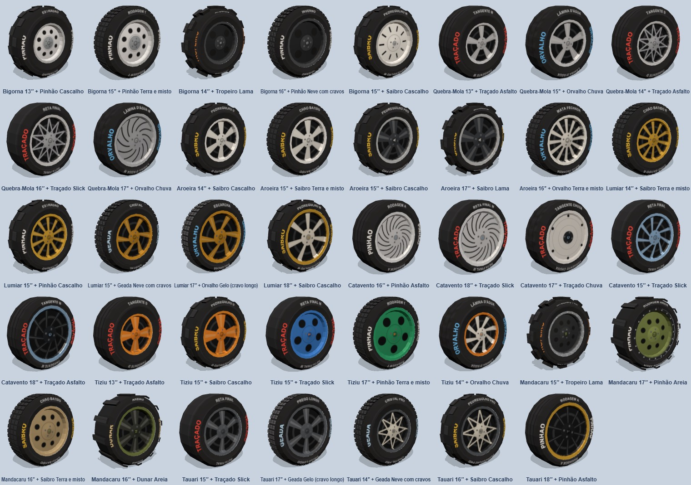

https://github.com/user-attachments/assets/a73b689d-2dd8-4370-ba1c-fab00e3bda2e

▶️ **[Assista ao vídeo no YouTube](https://www.youtube.com/watch?v=1N9vVgjuItI)** · **[Baixe no itch.io](https://kkyqr.itch.io/scitizia-wheels-64)** (grátis, doação opcional)

**Scitizia: rodas e pneus 64 bits** é uma coleção gratuita de rodas e pneus de carro em baixo polígono (low poly), com o visual retrô dos consoles de 64 bits, prontos para jogos de corrida em tempo real: **39 rodas** de 8 marcas inventadas (aro 13 a 18, aço, liga, forjadas e magnésio), **36 pneus** (29 linhas de 7 marcas inventadas e 7 pneus de série) em 9 tipos, do slick ao cravo longo para gelo, e **39 conjuntos montados** de roda e pneu, cada um com a versão do lado direito. São 153 arquivos glTF 2.0 binários (`.glb`) de 46,9 a 192,3 KB, com 336 a 1.872 triângulos, pivô no centro do cubo e giro no eixo X, e texturas PNG pintadas por código (o desenho do aro, o letreiro do flanco e a banda de rodagem) com filtro "nearest". As rodas e os pneus são os mesmos do jogo **Scitizia Rally Championship**; marcas, nomes e logotipos são inventados, sem nenhuma marca real.

**English summary:** Scitizia 64-bit wheels and tires is a free pack of low-poly car wheels and tyres with a retro 64-bit console look: 39 wheels (rims) from 8 made-up brands in 13 to 18 inch sizes (pressed steel, cast alloy, forged and magnesium; spokes, holes, mesh, turbine, aero disc and beadlock designs), 36 tyres in 9 types (slick, tarmac, wet, gravel, dirt, mud, snow with studs, ice with long studs and sand paddles) with the brand lettering on the sidewall, and 39 ready-to-use wheel + tyre sets, each in a left and a mirrored right version. Every model is a binary glTF 2.0 (`.glb`) file with 336 to 1872 triangles and embedded PNG textures (nearest filtering). The pivot is the hub center and the spin axis is X; units are meters, Y is up and the outer face points to +X. A machine-readable list with sizes and per-surface usage notes is in [`catalogo.json`](catalogo.json). Public domain (CC0 1.0).

## Resumo

| | |
|---|---|
| Modelos | 153: 39 rodas sozinhas, 36 pneus sozinhos e 39 conjuntos montados (× 2 lados) |
| Formato | glTF 2.0 binário (`.glb`), texturas também em PNG |
| Triângulos | rodas 432, pneus 336 a 1.776, conjuntos 432 a 1.872 |
| Tamanho | 46,9 a 192,3 KB por arquivo, com as texturas embutidas |
| Rodas | 8 marcas, aro 13, 14, 15, 16, 17, 18; aço, liga fundida, forjada e magnésio forjado |
| Pneus | 9 tipos: asfalto, slick, chuva, cascalho, terra e misto, lama, neve com cravos, gelo (cravo longo), areia; borracha macia, média ou dura; aro 15 |
| Medida de referência | pneu de 660 mm de diâmetro e 215 mm de largura; cada tipo muda um pouco a altura e a largura |
| Texturas | aro 256×256 px e pneu 512×256 px (flanco, banda e face dos blocos), filtro "nearest" na ampliação |
| Escala e eixos | metros, Y para cima, giro em torno de X, pivô no centro do cubo, face de fora para +X |
| Catálogo legível por máquina | [`catalogo.json`](catalogo.json) |
| Licença | domínio público, [CC0 1.0](LICENSE) |

## Conjuntos montados

Roda e pneu num arquivo só, prontos para pôr no carro: uma malha com dois materiais (`Pneu` e `Aro`), exatamente como no jogo. Cada roda ganhou um pneu que combina com a marca, e todos os 9 tipos de pneu aparecem. `<id>.glb` é o lado esquerdo (face para +X) e `<id>_direita.glb` o direito (espelhado, face para −X, com o letreiro legível e a banda direcional no mesmo sentido). 39 conjuntos.

| Prévia | Conjunto | Triângulos | Tamanho |
|---|---|---|---|
| 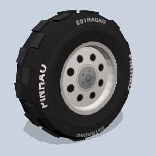 | **Bigorna Estampada 13″ + Pinhão Estradão**<br>Cascalho<br>`bigorna_estampada_13_com_pinhao_estradao`<br>[direita](modelos/conjuntos/bigorna_estampada_13_com_pinhao_estradao_direita.glb) | 672 | 96,5 KB |
| 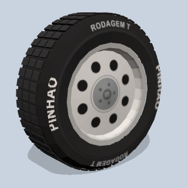 | **Bigorna Estampada 15″ + Pinhão Rodagem T**<br>Terra e misto<br>`bigorna_estampada_15_com_pinhao_rodagem_t`<br>[direita](modelos/conjuntos/bigorna_estampada_15_com_pinhao_rodagem_t_direita.glb) | 1.872 | 178,8 KB |
| 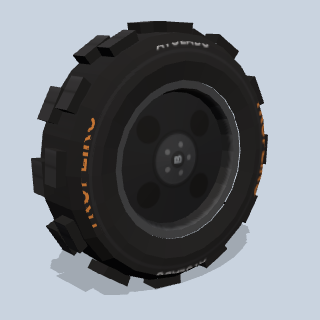 | **Bigorna Reforçada de Rali 14″ + Tropeiro Atolado**<br>Lama<br>`bigorna_reforcada_14_com_tropeiro_atolado`<br>[direita](modelos/conjuntos/bigorna_reforcada_14_com_tropeiro_atolado_direita.glb) | 672 | 95,0 KB |
| 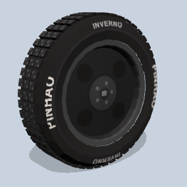 | **Bigorna Reforçada de Rali 16″ + Pinhão Inverno**<br>Neve com cravos<br>`bigorna_reforcada_16_com_pinhao_inverno`<br>[direita](modelos/conjuntos/bigorna_reforcada_16_com_pinhao_inverno_direita.glb) | 1.872 | 175,9 KB |
| 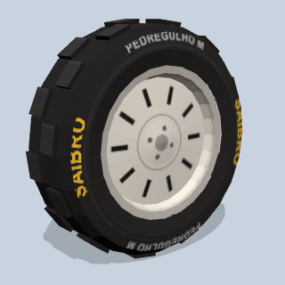 | **Bigorna Ventilada Branca 15″ + Saibro Pedregulho M**<br>Cascalho<br>`bigorna_ventilada_15_com_saibro_pedregulho_m`<br>[direita](modelos/conjuntos/bigorna_ventilada_15_com_saibro_pedregulho_m_direita.glb) | 672 | 96,7 KB |
| 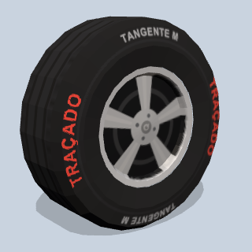 | **Quebra-Mola Estrela 13″ + Traçado Tangente M**<br>Asfalto<br>`quebramola_estrela_13_com_tracado_tangente_m`<br>[direita](modelos/conjuntos/quebramola_estrela_13_com_tracado_tangente_m_direita.glb) | 432 | 88,4 KB |
| 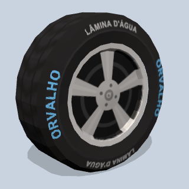 | **Quebra-Mola Estrela 15″ + Orvalho Lâmina d'Água**<br>Chuva<br>`quebramola_estrela_15_com_orvalho_lamina`<br>[direita](modelos/conjuntos/quebramola_estrela_15_com_orvalho_lamina_direita.glb) | 432 | 92,1 KB |
| 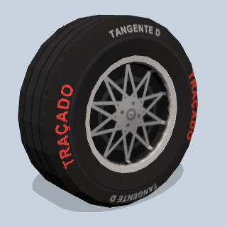 | **Quebra-Mola Malha 14″ + Traçado Tangente D**<br>Asfalto<br>`quebramola_malha_14_com_tracado_tangente_d`<br>[direita](modelos/conjuntos/quebramola_malha_14_com_tracado_tangente_d_direita.glb) | 432 | 95,3 KB |
| 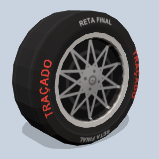 | **Quebra-Mola Malha 16″ + Traçado Reta Final**<br>Slick<br>`quebramola_malha_16_com_tracado_reta_final`<br>[direita](modelos/conjuntos/quebramola_malha_16_com_tracado_reta_final_direita.glb) | 432 | 93,4 KB |
| 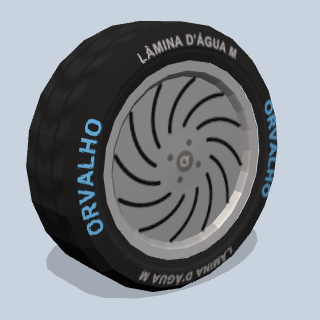 | **Quebra-Mola Turbina 17″ + Orvalho Lâmina d'Água M**<br>Chuva<br>`quebramola_turbina_17_com_orvalho_lamina_m`<br>[direita](modelos/conjuntos/quebramola_turbina_17_com_orvalho_lamina_m_direita.glb) | 432 | 88,6 KB |
| 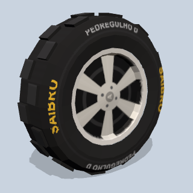 | **Aroeira Seis Raios 14″ + Saibro Pedregulho D**<br>Cascalho<br>`aroeira_seis_14_com_saibro_pedregulho_d`<br>[direita](modelos/conjuntos/aroeira_seis_14_com_saibro_pedregulho_d_direita.glb) | 672 | 101,5 KB |
| 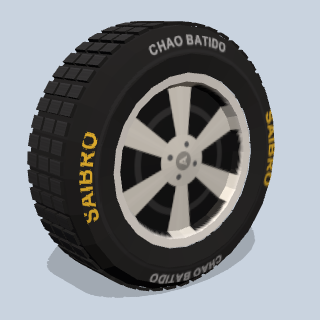 | **Aroeira Seis Raios 15″ + Saibro Chão Batido**<br>Terra e misto<br>`aroeira_seis_15_com_saibro_chao_batido`<br>[direita](modelos/conjuntos/aroeira_seis_15_com_saibro_chao_batido_direita.glb) | 1.872 | 182,6 KB |
| 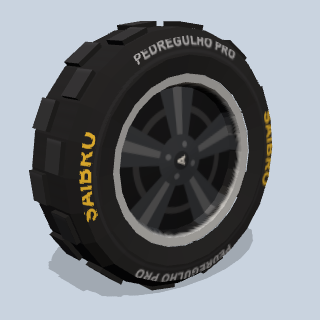 | **Aroeira Cinco Largos 15″ + Saibro Pedregulho Pro**<br>Cascalho<br>`aroeira_cinco_15_com_saibro_pedregulho_pro`<br>[direita](modelos/conjuntos/aroeira_cinco_15_com_saibro_pedregulho_pro_direita.glb) | 672 | 103,8 KB |
| 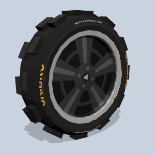 | **Aroeira Cinco Largos 17″ + Saibro Barreiro**<br>Lama<br>`aroeira_cinco_17_com_saibro_barreiro`<br>[direita](modelos/conjuntos/aroeira_cinco_17_com_saibro_barreiro_direita.glb) | 672 | 100,8 KB |
| 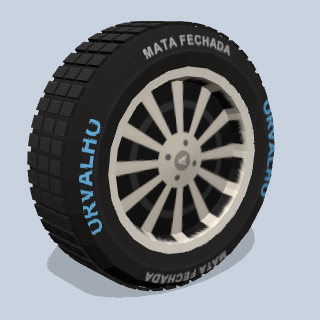 | **Aroeira Doze Raios 16″ + Orvalho Mata Fechada**<br>Terra e misto<br>`aroeira_doze_16_com_orvalho_mata_fechada`<br>[direita](modelos/conjuntos/aroeira_doze_16_com_orvalho_mata_fechada_direita.glb) | 1.872 | 192,3 KB |
| 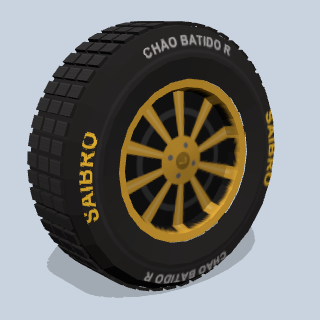 | **Lumiar Dez Raios 14″ + Saibro Chão Batido R**<br>Terra e misto<br>`lumiar_dez_14_com_saibro_chao_batido_r`<br>[direita](modelos/conjuntos/lumiar_dez_14_com_saibro_chao_batido_r_direita.glb) | 1.872 | 189,5 KB |
| 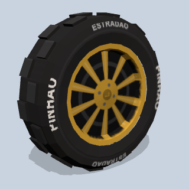 | **Lumiar Dez Raios 15″ + Pinhão Estradão**<br>Cascalho<br>`lumiar_dez_15_com_pinhao_estradao`<br>[direita](modelos/conjuntos/lumiar_dez_15_com_pinhao_estradao_direita.glb) | 672 | 105,7 KB |
| 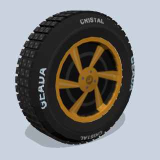 | **Lumiar Lâmina 15″ + Geada Cristal**<br>Neve com cravos<br>`lumiar_lamina_15_com_geada_cristal`<br>[direita](modelos/conjuntos/lumiar_lamina_15_com_geada_cristal_direita.glb) | 1.872 | 184,1 KB |
| 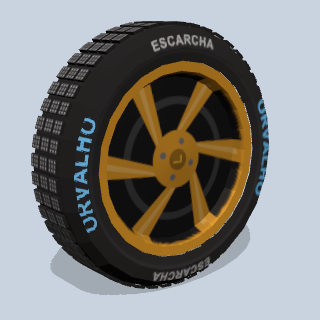 | **Lumiar Lâmina 17″ + Orvalho Escarcha**<br>Gelo (cravo longo)<br>`lumiar_lamina_17_com_orvalho_escarcha`<br>[direita](modelos/conjuntos/lumiar_lamina_17_com_orvalho_escarcha_direita.glb) | 1.872 | 189,6 KB |
| 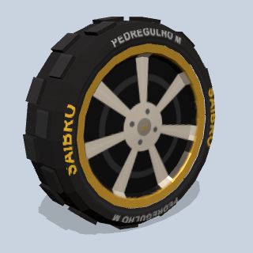 | **Lumiar Estrela Forjada 18″ + Saibro Pedregulho M**<br>Cascalho<br>`lumiar_estrela_18_com_saibro_pedregulho_m`<br>[direita](modelos/conjuntos/lumiar_estrela_18_com_saibro_pedregulho_m_direita.glb) | 672 | 106,3 KB |
| 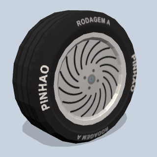 | **Catavento Hélice 16″ + Pinhão Rodagem A**<br>Asfalto<br>`catavento_helice_16_com_pinhao_rodagem_a`<br>[direita](modelos/conjuntos/catavento_helice_16_com_pinhao_rodagem_a_direita.glb) | 432 | 85,1 KB |
| 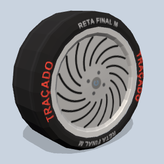 | **Catavento Hélice 18″ + Traçado Reta Final M**<br>Slick<br>`catavento_helice_18_com_tracado_reta_final_m`<br>[direita](modelos/conjuntos/catavento_helice_18_com_tracado_reta_final_m_direita.glb) | 432 | 85,2 KB |
| 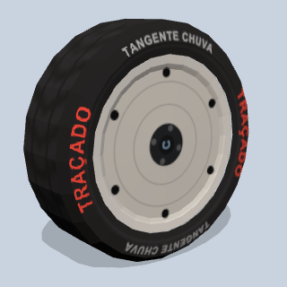 | **Catavento Disco Aero 17″ + Traçado Tangente Chuva**<br>Chuva<br>`catavento_disco_17_com_tracado_tangente_chuva`<br>[direita](modelos/conjuntos/catavento_disco_17_com_tracado_tangente_chuva_direita.glb) | 432 | 90,3 KB |
| 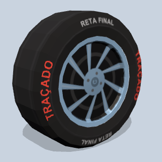 | **Catavento Pás Curvas 15″ + Traçado Reta Final**<br>Slick<br>`catavento_pas_15_com_tracado_reta_final`<br>[direita](modelos/conjuntos/catavento_pas_15_com_tracado_reta_final_direita.glb) | 432 | 92,8 KB |
| 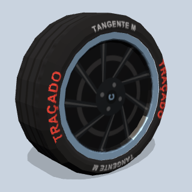 | **Catavento Pás Curvas 18″ + Traçado Tangente M**<br>Asfalto<br>`catavento_pas_18_com_tracado_tangente_m`<br>[direita](modelos/conjuntos/catavento_pas_18_com_tracado_tangente_m_direita.glb) | 432 | 93,3 KB |
| 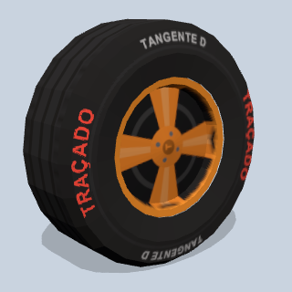 | **Tiziu Cruzeta 13″ + Traçado Tangente D**<br>Asfalto<br>`tiziu_cruzeta_13_com_tracado_tangente_d`<br>[direita](modelos/conjuntos/tiziu_cruzeta_13_com_tracado_tangente_d_direita.glb) | 432 | 83,5 KB |
| 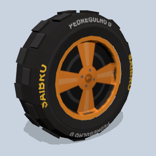 | **Tiziu Cruzeta 15″ + Saibro Pedregulho D**<br>Cascalho<br>`tiziu_cruzeta_15_com_saibro_pedregulho_d`<br>[direita](modelos/conjuntos/tiziu_cruzeta_15_com_saibro_pedregulho_d_direita.glb) | 672 | 98,6 KB |
| 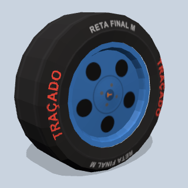 | **Tiziu Cinco Vazados 15″ + Traçado Reta Final M**<br>Slick<br>`tiziu_vazada_15_com_tracado_reta_final_m`<br>[direita](modelos/conjuntos/tiziu_vazada_15_com_tracado_reta_final_m_direita.glb) | 432 | 81,4 KB |
| 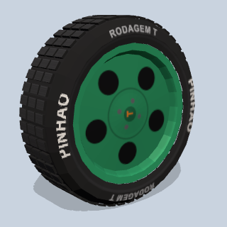 | **Tiziu Cinco Vazados 17″ + Pinhão Rodagem T**<br>Terra e misto<br>`tiziu_vazada_17_com_pinhao_rodagem_t`<br>[direita](modelos/conjuntos/tiziu_vazada_17_com_pinhao_rodagem_t_direita.glb) | 1.872 | 177,5 KB |
| 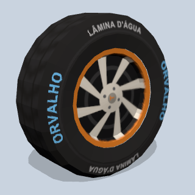 | **Tiziu Leque 14″ + Orvalho Lâmina d'Água**<br>Chuva<br>`tiziu_leque_14_com_orvalho_lamina`<br>[direita](modelos/conjuntos/tiziu_leque_14_com_orvalho_lamina_direita.glb) | 432 | 94,5 KB |
|  | **Mandacaru Trava de Talão 15″ + Tropeiro Atolado Pro**<br>Lama<br>`mandacaru_trava_15_com_tropeiro_atolado_pro`<br>[direita](modelos/conjuntos/mandacaru_trava_15_com_tropeiro_atolado_pro_direita.glb) | 672 | 97,5 KB |
| 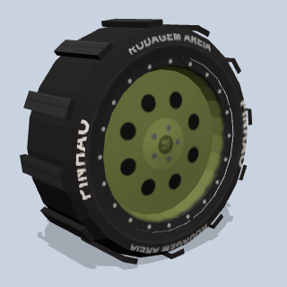 | **Mandacaru Trava de Talão 17″ + Pinhão Rodagem Areia**<br>Areia<br>`mandacaru_trava_17_com_pinhao_rodagem_areia`<br>[direita](modelos/conjuntos/mandacaru_trava_17_com_pinhao_rodagem_areia_direita.glb) | 552 | 89,5 KB |
| 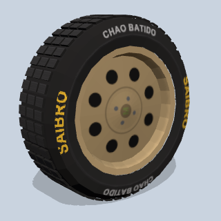 | **Mandacaru Sertão Oito Furos 16″ + Saibro Chão Batido**<br>Terra e misto<br>`mandacaru_sertao_16_com_saibro_chao_batido`<br>[direita](modelos/conjuntos/mandacaru_sertao_16_com_saibro_chao_batido_direita.glb) | 1.872 | 178,7 KB |
| 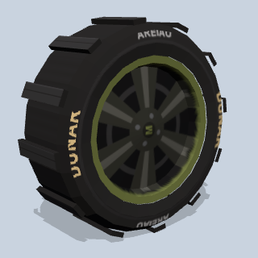 | **Mandacaru Lajedo 16″ + Dunar Areião**<br>Areia<br>`mandacaru_lajedo_16_com_dunar_areiao`<br>[direita](modelos/conjuntos/mandacaru_lajedo_16_com_dunar_areiao_direita.glb) | 552 | 89,5 KB |
| 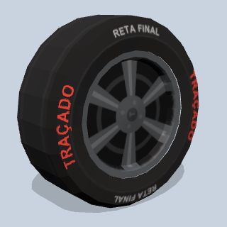 | **Tauari Magnésio Seis 15″ + Traçado Reta Final**<br>Slick<br>`tauari_magnesio_15_com_tracado_reta_final`<br>[direita](modelos/conjuntos/tauari_magnesio_15_com_tracado_reta_final_direita.glb) | 432 | 84,5 KB |
| 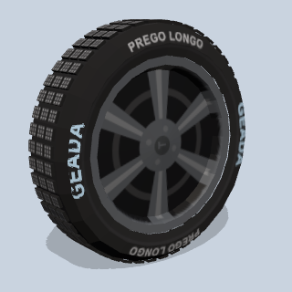 | **Tauari Magnésio Seis 17″ + Geada Prego Longo**<br>Gelo (cravo longo)<br>`tauari_magnesio_17_com_geada_prego_longo`<br>[direita](modelos/conjuntos/tauari_magnesio_17_com_geada_prego_longo_direita.glb) | 1.872 | 186,1 KB |
| 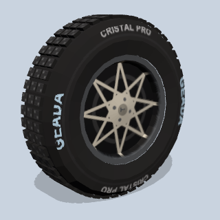 | **Tauari Malha de Magnésio 14″ + Geada Cristal Pro**<br>Neve com cravos<br>`tauari_malha_14_com_geada_cristal_pro`<br>[direita](modelos/conjuntos/tauari_malha_14_com_geada_cristal_pro_direita.glb) | 1.872 | 190,1 KB |
| 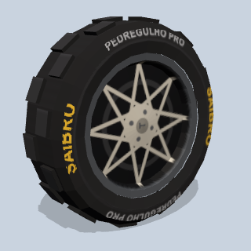 | **Tauari Malha de Magnésio 16″ + Saibro Pedregulho Pro**<br>Cascalho<br>`tauari_malha_16_com_saibro_pedregulho_pro`<br>[direita](modelos/conjuntos/tauari_malha_16_com_saibro_pedregulho_pro_direita.glb) | 672 | 109,8 KB |
| 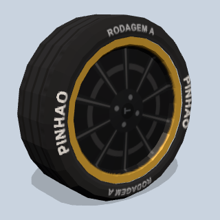 | **Tauari Monobloco Dez 18″ + Pinhão Rodagem A**<br>Asfalto<br>`tauari_monobloco_18_com_pinhao_rodagem_a`<br>[direita](modelos/conjuntos/tauari_monobloco_18_com_pinhao_rodagem_a_direita.glb) | 432 | 90,5 KB |

## Rodas

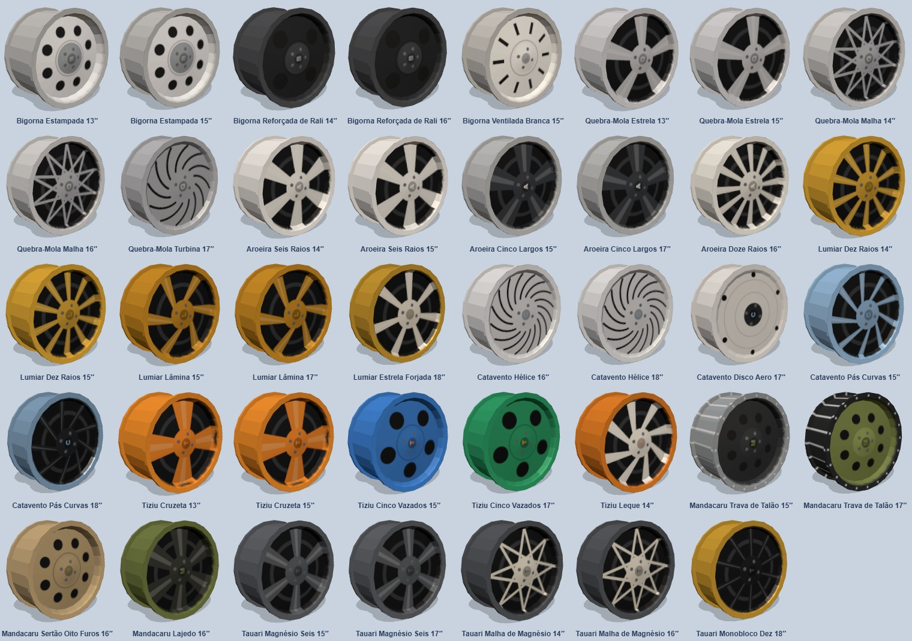

Cada roda (aro) vem sozinha, com a face desenhada (raios, furos, malha, hélice, disco ou trava de talão), a aba, o tambor e o fundo fechados: serve para vitrine, estoque de oficina ou para montar com outro pneu. As que existem em mais de um aro vêm uma vez por aro. 39 rodas.

### Bigorna

Aço estampado que entorta e não quebra: a roda do rali raiz. 5 rodas.

| Prévia | Roda | Aro | Material | Desenho | Peso | Triângulos | Tamanho |
|---|---|---|---|---|---|---|---|
| 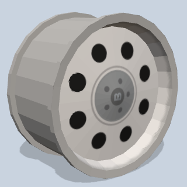 | **Bigorna Estampada**<br>`bigorna_estampada_13` | 13″ | Aço | estampada com furos | 6,7 kg | 432 | 49,3 KB |
| 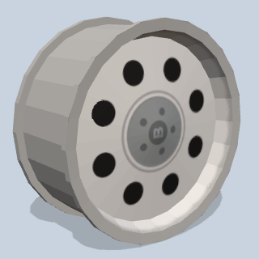 | **Bigorna Estampada**<br>`bigorna_estampada_15` | 15″ | Aço | estampada com furos | 8,2 kg | 432 | 49,3 KB |
| 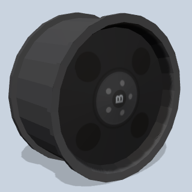 | **Bigorna Reforçada de Rali**<br>`bigorna_reforcada_14` | 14″ | Aço | estampada com furos | 7,5 kg | 432 | 46,9 KB |
| 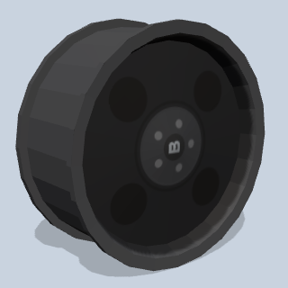 | **Bigorna Reforçada de Rali**<br>`bigorna_reforcada_16` | 16″ | Aço | estampada com furos | 9,0 kg | 432 | 46,9 KB |
| 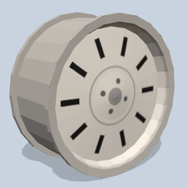 | **Bigorna Ventilada Branca**<br>`bigorna_ventilada_15` | 15″ | Aço | estampada com fendas | 8,2 kg | 432 | 47,5 KB |

### Quebra-Mola

Liga popular de rua, barata e bonita no estacionamento. 5 rodas.

| Prévia | Roda | Aro | Material | Desenho | Peso | Triângulos | Tamanho |
|---|---|---|---|---|---|---|---|
| 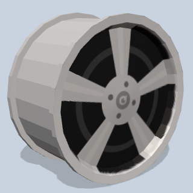 | **Quebra-Mola Estrela**<br>`quebramola_estrela_13` | 13″ | Liga fundida | raios (5) | 5,6 kg | 432 | 54,2 KB |
| 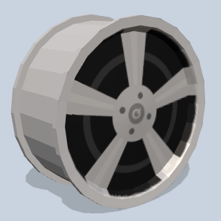 | **Quebra-Mola Estrela**<br>`quebramola_estrela_15` | 15″ | Liga fundida | raios (5) | 6,9 kg | 432 | 54,2 KB |
| 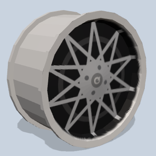 | **Quebra-Mola Malha**<br>`quebramola_malha_14` | 14″ | Liga fundida | malha cruzada (10) | 6,3 kg | 432 | 61,3 KB |
| 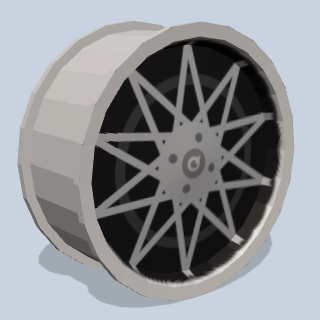 | **Quebra-Mola Malha**<br>`quebramola_malha_16` | 16″ | Liga fundida | malha cruzada (10) | 7,6 kg | 432 | 61,3 KB |
| 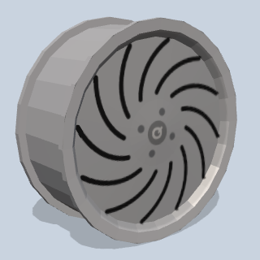 | **Quebra-Mola Turbina**<br>`quebramola_turbina_17` | 17″ | Liga fundida | hélice (12) | 8,2 kg | 432 | 49,9 KB |

### Aroeira

Liga fundida de rali: raio grosso, aguenta pedra e sarjeta. 5 rodas.

| Prévia | Roda | Aro | Material | Desenho | Peso | Triângulos | Tamanho |
|---|---|---|---|---|---|---|---|
|  | **Aroeira Seis Raios**<br>`aroeira_seis_14` | 14″ | Liga fundida | raios (6) | 6,3 kg | 432 | 52,4 KB |
|  | **Aroeira Seis Raios**<br>`aroeira_seis_15` | 15″ | Liga fundida | raios (6) | 6,9 kg | 432 | 52,4 KB |
|  | **Aroeira Cinco Largos**<br>`aroeira_cinco_15` | 15″ | Liga fundida | raios (5) | 6,9 kg | 432 | 53,7 KB |
|  | **Aroeira Cinco Largos**<br>`aroeira_cinco_17` | 17″ | Liga fundida | raios (5) | 8,2 kg | 432 | 53,7 KB |
|  | **Aroeira Doze Raios**<br>`aroeira_doze_16` | 16″ | Liga fundida | raios (12) | 7,6 kg | 432 | 60,0 KB |

### Lumiar

Forjadas leves com o dourado das especiais de terra. 5 rodas.

| Prévia | Roda | Aro | Material | Desenho | Peso | Triângulos | Tamanho |
|---|---|---|---|---|---|---|---|
|  | **Lumiar Dez Raios**<br>`lumiar_dez_14` | 14″ | Forjada | raios (10) | 5,1 kg | 432 | 58,5 KB |
|  | **Lumiar Dez Raios**<br>`lumiar_dez_15` | 15″ | Forjada | raios (10) | 5,6 kg | 432 | 58,5 KB |
|  | **Lumiar Lâmina**<br>`lumiar_lamina_15` | 15″ | Forjada | lâminas curvas (6) | 5,6 kg | 432 | 55,6 KB |
|  | **Lumiar Lâmina**<br>`lumiar_lamina_17` | 17″ | Forjada | lâminas curvas (6) | 6,7 kg | 432 | 55,6 KB |
|  | **Lumiar Estrela Forjada**<br>`lumiar_estrela_18` | 18″ | Forjada | raios (7) | 7,3 kg | 432 | 57,1 KB |

### Catavento

Aros grandes e desenho de turbina para o asfalto rápido. 5 rodas.

| Prévia | Roda | Aro | Material | Desenho | Peso | Triângulos | Tamanho |
|---|---|---|---|---|---|---|---|
|  | **Catavento Hélice**<br>`catavento_helice_16` | 16″ | Liga fundida | hélice (16) | 7,6 kg | 432 | 52,5 KB |
|  | **Catavento Hélice**<br>`catavento_helice_18` | 18″ | Liga fundida | hélice (16) | 8,9 kg | 432 | 52,8 KB |
|  | **Catavento Disco Aero**<br>`catavento_disco_17` | 17″ | Forjada | disco fechado | 6,7 kg | 432 | 51,6 KB |
|  | **Catavento Pás Curvas**<br>`catavento_pas_15` | 15″ | Liga fundida | lâminas curvas (9) | 6,9 kg | 432 | 60,6 KB |
|  | **Catavento Pás Curvas**<br>`catavento_pas_18` | 18″ | Forjada | lâminas curvas (9) | 7,3 kg | 432 | 59,1 KB |

### Tiziu

Raios vazados e cores de passarinho: a cara dos kit cars. 5 rodas.

| Prévia | Roda | Aro | Material | Desenho | Peso | Triângulos | Tamanho |
|---|---|---|---|---|---|---|---|
|  | **Tiziu Cruzeta**<br>`tiziu_cruzeta_13` | 13″ | Liga fundida | raios (4) | 5,6 kg | 432 | 49,5 KB |
|  | **Tiziu Cruzeta**<br>`tiziu_cruzeta_15` | 15″ | Liga fundida | raios (4) | 6,9 kg | 432 | 49,5 KB |
|  | **Tiziu Cinco Vazados**<br>`tiziu_vazada_15` | 15″ | Liga fundida | estampada com furos | 6,9 kg | 432 | 48,7 KB |
|  | **Tiziu Cinco Vazados**<br>`tiziu_vazada_17` | 17″ | Forjada | estampada com furos | 6,7 kg | 432 | 48,0 KB |
|  | **Tiziu Leque**<br>`tiziu_leque_14` | 14″ | Liga fundida | lâminas curvas (8) | 6,3 kg | 432 | 56,6 KB |

### Mandacaru

Trava de talão e liga reforçada para quem anda fora da estrada. 4 rodas.

| Prévia | Roda | Aro | Material | Desenho | Peso | Triângulos | Tamanho |
|---|---|---|---|---|---|---|---|
|  | **Mandacaru Trava de Talão**<br>`mandacaru_trava_15` | 15″ | Aço | trava de talão | 8,2 kg | 432 | 47,7 KB |
|  | **Mandacaru Trava de Talão**<br>`mandacaru_trava_17` | 17″ | Liga fundida | trava de talão | 8,2 kg | 432 | 48,6 KB |
|  | **Mandacaru Sertão Oito Furos**<br>`mandacaru_sertao_16` | 16″ | Liga fundida | estampada com furos | 7,6 kg | 432 | 48,5 KB |
|  | **Mandacaru Lajedo**<br>`mandacaru_lajedo_16` | 16″ | Forjada | raios (6) | 6,1 kg | 432 | 52,5 KB |

### Tauari

Magnésio forjado de competição: a roda mais leve do parque. 5 rodas.

| Prévia | Roda | Aro | Material | Desenho | Peso | Triângulos | Tamanho |
|---|---|---|---|---|---|---|---|
|  | **Tauari Magnésio Seis**<br>`tauari_magnesio_15` | 15″ | Magnésio forjado | raios (6) | 4,7 kg | 432 | 52,3 KB |
|  | **Tauari Magnésio Seis**<br>`tauari_magnesio_17` | 17″ | Magnésio forjado | raios (6) | 5,7 kg | 432 | 52,3 KB |
|  | **Tauari Malha de Magnésio**<br>`tauari_malha_14` | 14″ | Magnésio forjado | malha cruzada (8) | 4,2 kg | 432 | 59,7 KB |
|  | **Tauari Malha de Magnésio**<br>`tauari_malha_16` | 16″ | Magnésio forjado | malha cruzada (8) | 5,2 kg | 432 | 59,7 KB |
|  | **Tauari Monobloco Dez**<br>`tauari_monobloco_18` | 18″ | Magnésio forjado | raios (10) | 6,1 kg | 432 | 57,9 KB |

## Pneus


Cada pneu vem sozinho, no aro 15, com flanco de fora e de dentro, talão e a banda do tipo: as garras, os blocos e as pás são relevo de verdade na malha; sulcos, lamelas e cravos estão na textura. O nome da marca e da linha está escrito no flanco. 36 pneus: 29 linhas de marca e 7 de série (letreiro "RALI").

### Tipos de pneu

Onde cada tipo rende mais ou perde, comparado com um pneu misto de série (é o que o jogo usa na física; as linhas de marca e a borracha só melhoram ou pioram um pouco dentro do tipo):

| Tipo | Banda | Onde usar |
|---|---|---|
| Asfalto | Sulcos longitudinais | Rende mais em asfalto, asfalto sujo e ponte de madeira; perde em lama, neve, gelo e areia. |
| Slick | Lisa (slick) | Rende mais em asfalto; na média em asfalto sujo e ponte de madeira; perde em cascalho, terra, grama, lama, neve, gelo, areia e água rasa; perde muito na chuva. |
| Chuva | Sulcos em flecha | Rende mais em asfalto, asfalto sujo e ponte de madeira; na média em cascalho, terra e grama; tira água e segura bem na chuva. |
| Cascalho | Blocos alternados | Rende mais em cascalho, terra e grama; na média em asfalto sujo, ponte de madeira, lama, gelo, areia e água rasa; aguenta chuva. |
| Terra e misto | Blocos pequenos com lamelas | Rende mais em terra, cascalho, grama e lama; na média em asfalto, asfalto sujo, ponte de madeira, neve, gelo, areia e água rasa; aguenta chuva. |
| Lama | Garras altas em V | Rende mais em lama, água rasa, grama e terra; na média em cascalho e neve; perde em asfalto; aguenta chuva. |
| Neve com cravos | Blocos com lamelas | Rende mais em gelo e neve; na média em terra; perde em asfalto e asfalto sujo. |
| Gelo (cravo longo) | Blocos com lamelas | Rende mais em gelo e neve; perde em asfalto, asfalto sujo e ponte de madeira. |
| Areia | Pás transversais | Rende mais em areia e cascalho; na média em asfalto sujo, ponte de madeira, terra, grama, lama, neve, gelo e água rasa. |

### Saibro

Nasceu nas estradas de terra do interior e só pensa em cascalho. 6 pneus.

| Prévia | Pneu | Tipo | Borracha | Medida | Uso por piso | Triângulos | Tamanho |
|---|---|---|---|---|---|---|---|
|  | **Saibro Pedregulho M**<br>`saibro_pedregulho_m` | Cascalho<br>blocos alternados | macia | 206 mm × 667 mm, aro 15 | Rende mais em cascalho, terra e grama (resto na tabela de tipos). | 576 | 68,7 KB |
|  | **Saibro Pedregulho D**<br>`saibro_pedregulho_d` | Cascalho<br>blocos alternados | dura | 206 mm × 667 mm, aro 15 | Rende mais em cascalho, terra e grama (resto na tabela de tipos). | 576 | 68,6 KB |
|  | **Saibro Pedregulho Pro**<br>`saibro_pedregulho_pro` | Cascalho<br>blocos alternados | macia | 206 mm × 667 mm, aro 15 | Rende mais em cascalho, terra e grama (resto na tabela de tipos). | 576 | 69,5 KB |
|  | **Saibro Chão Batido**<br>`saibro_chao_batido` | Terra e misto<br>blocos pequenos com lamelas | média | 215 mm × 660 mm, aro 15 | Rende mais em terra, cascalho, grama e lama (resto na tabela de tipos). | 1.776 | 149,7 KB |
|  | **Saibro Chão Batido R**<br>`saibro_chao_batido_r` | Terra e misto<br>blocos pequenos com lamelas | macia | 215 mm × 660 mm, aro 15 | Rende mais em terra, cascalho, grama e lama (resto na tabela de tipos). | 1.776 | 150,5 KB |
|  | **Saibro Barreiro**<br>`saibro_barreiro` | Lama<br>garras altas em V | dura | 181 mm × 677 mm, aro 15 | Rende mais em lama, água rasa, grama e terra (resto na tabela de tipos). | 576 | 66,6 KB |

### Geada

Inverno de verdade: cravos, lamelas e borracha que não endurece no frio. 4 pneus.

| Prévia | Pneu | Tipo | Borracha | Medida | Uso por piso | Triângulos | Tamanho |
|---|---|---|---|---|---|---|---|
|  | **Geada Cristal**<br>`geada_cristal` | Neve com cravos<br>blocos com lamelas, cravos curtos | média | 185 mm × 670 mm, aro 15 | Rende mais em gelo e neve (resto na tabela de tipos). | 1.776 | 148,0 KB |
|  | **Geada Cristal Pro**<br>`geada_cristal_pro` | Neve com cravos<br>blocos com lamelas, cravos curtos | macia | 185 mm × 670 mm, aro 15 | Rende mais em gelo e neve (resto na tabela de tipos). | 1.776 | 149,9 KB |
|  | **Geada Prego Longo**<br>`geada_prego_longo` | Gelo (cravo longo)<br>blocos com lamelas, cravos longos | média | 176 mm × 667 mm, aro 15 | Rende mais em gelo e neve (resto na tabela de tipos). | 1.776 | 153,2 KB |
|  | **Geada Prego Longo Pro**<br>`geada_prego_longo_pro` | Gelo (cravo longo)<br>blocos com lamelas, cravos longos | macia | 176 mm × 667 mm, aro 15 | Rende mais em gelo e neve (resto na tabela de tipos). | 1.776 | 155,0 KB |

### Traçado

Borracha de asfalto para quem vive na linha certa. 5 pneus.

| Prévia | Pneu | Tipo | Borracha | Medida | Uso por piso | Triângulos | Tamanho |
|---|---|---|---|---|---|---|---|
|  | **Traçado Reta Final**<br>`tracado_reta_final` | Slick<br>lisa (slick) | média | 237 mm × 647 mm, aro 15 | Rende mais em asfalto (resto na tabela de tipos). | 336 | 51,6 KB |
|  | **Traçado Reta Final M**<br>`tracado_reta_final_m` | Slick<br>lisa (slick) | macia | 237 mm × 647 mm, aro 15 | Rende mais em asfalto (resto na tabela de tipos). | 336 | 52,2 KB |
|  | **Traçado Tangente M**<br>`tracado_tangente_m` | Asfalto<br>sulcos longitudinais | macia | 228 mm × 653 mm, aro 15 | Rende mais em asfalto, asfalto sujo e ponte de madeira (resto na tabela de tipos). | 336 | 53,7 KB |
|  | **Traçado Tangente D**<br>`tracado_tangente_d` | Asfalto<br>sulcos longitudinais | dura | 228 mm × 653 mm, aro 15 | Rende mais em asfalto, asfalto sujo e ponte de madeira (resto na tabela de tipos). | 336 | 53,5 KB |
|  | **Traçado Tangente Chuva**<br>`tracado_tangente_chuva` | Chuva<br>sulcos em flecha | média | 219 mm × 660 mm, aro 15 | Rende mais em asfalto, asfalto sujo e ponte de madeira (resto na tabela de tipos). | 336 | 58,2 KB |

### Tropeiro

Garra larga e funda: atravessa atoleiro e vau. 2 pneus.

| Prévia | Pneu | Tipo | Borracha | Medida | Uso por piso | Triângulos | Tamanho |
|---|---|---|---|---|---|---|---|
|  | **Tropeiro Atolado**<br>`tropeiro_atolado` | Lama<br>garras altas em V | média | 181 mm × 677 mm, aro 15 | Rende mais em lama, água rasa, grama e terra (resto na tabela de tipos). | 576 | 67,6 KB |
|  | **Tropeiro Atolado Pro**<br>`tropeiro_atolado_pro` | Lama<br>garras altas em V | macia | 181 mm × 677 mm, aro 15 | Rende mais em lama, água rasa, grama e terra (resto na tabela de tipos). | 576 | 69,3 KB |

### Dunar

Carcaça mole e banda larga para flutuar na areia. 3 pneus.

| Prévia | Pneu | Tipo | Borracha | Medida | Uso por piso | Triângulos | Tamanho |
|---|---|---|---|---|---|---|---|
|  | **Dunar Areião**<br>`dunar_areiao` | Areia<br>pás transversais | média | 241 mm × 673 mm, aro 15 | Rende mais em areia e cascalho (resto na tabela de tipos). | 456 | 56,4 KB |
|  | **Dunar Miragem**<br>`dunar_miragem` | Areia<br>pás transversais | dura | 241 mm × 673 mm, aro 15 | Rende mais em areia e cascalho (resto na tabela de tipos). | 456 | 57,8 KB |
|  | **Dunar Areião Pro**<br>`dunar_areiao_pro` | Areia<br>pás transversais | macia | 241 mm × 673 mm, aro 15 | Rende mais em areia e cascalho (resto na tabela de tipos). | 456 | 58,5 KB |

### Orvalho

Sulcos que tiram água do caminho antes de o pneu chegar. 4 pneus.

| Prévia | Pneu | Tipo | Borracha | Medida | Uso por piso | Triângulos | Tamanho |
|---|---|---|---|---|---|---|---|
|  | **Orvalho Lâmina d'Água**<br>`orvalho_lamina` | Chuva<br>sulcos em flecha | média | 219 mm × 660 mm, aro 15 | Rende mais em asfalto, asfalto sujo e ponte de madeira (resto na tabela de tipos). | 336 | 57,4 KB |
|  | **Orvalho Lâmina d'Água M**<br>`orvalho_lamina_m` | Chuva<br>sulcos em flecha | macia | 219 mm × 660 mm, aro 15 | Rende mais em asfalto, asfalto sujo e ponte de madeira (resto na tabela de tipos). | 336 | 58,1 KB |
|  | **Orvalho Mata Fechada**<br>`orvalho_mata_fechada` | Terra e misto<br>blocos pequenos com lamelas | macia | 215 mm × 660 mm, aro 15 | Rende mais em terra, cascalho, grama e lama (resto na tabela de tipos). | 1.776 | 151,7 KB |
|  | **Orvalho Escarcha**<br>`orvalho_escarcha` | Gelo (cravo longo)<br>blocos com lamelas, cravos longos | média | 176 mm × 667 mm, aro 15 | Rende mais em gelo e neve (resto na tabela de tipos). | 1.776 | 153,5 KB |

### Pinhão

Pneu de batalha: dura muito, custa pouco e anda em tudo. 5 pneus.

| Prévia | Pneu | Tipo | Borracha | Medida | Uso por piso | Triângulos | Tamanho |
|---|---|---|---|---|---|---|---|
|  | **Pinhão Rodagem A**<br>`pinhao_rodagem_a` | Asfalto<br>sulcos longitudinais | dura | 228 mm × 653 mm, aro 15 | Rende mais em asfalto, asfalto sujo e ponte de madeira (resto na tabela de tipos). | 336 | 52,0 KB |
|  | **Pinhão Estradão**<br>`pinhao_estradao` | Cascalho<br>blocos alternados | dura | 206 mm × 667 mm, aro 15 | Rende mais em cascalho, terra e grama (resto na tabela de tipos). | 576 | 66,6 KB |
|  | **Pinhão Rodagem T**<br>`pinhao_rodagem_t` | Terra e misto<br>blocos pequenos com lamelas | média | 215 mm × 660 mm, aro 15 | Rende mais em terra, cascalho, grama e lama (resto na tabela de tipos). | 1.776 | 149,0 KB |
|  | **Pinhão Inverno**<br>`pinhao_inverno` | Neve com cravos<br>blocos com lamelas, cravos curtos | média | 185 mm × 670 mm, aro 15 | Rende mais em gelo e neve (resto na tabela de tipos). | 1.776 | 148,5 KB |
|  | **Pinhão Rodagem Areia**<br>`pinhao_rodagem_areia` | Areia<br>pás transversais | dura | 241 mm × 673 mm, aro 15 | Rende mais em areia e cascalho (resto na tabela de tipos). | 456 | 60,8 KB |

### Pneus de série

Os pneus que vêm no carro, um de cada tipo, com o letreiro genérico RALI. 7 pneus.

| Prévia | Pneu | Tipo | Borracha | Medida | Uso por piso | Triângulos | Tamanho |
|---|---|---|---|---|---|---|---|
|  | **Série misto**<br>`serie_misto` | Terra e misto<br>blocos pequenos com lamelas | média | 215 mm × 660 mm, aro 15 | Rende mais em terra, cascalho, grama e lama (resto na tabela de tipos). | 1.776 | 145,0 KB |
|  | **Série asfalto**<br>`serie_asfalto` | Asfalto<br>sulcos longitudinais | média | 228 mm × 653 mm, aro 15 | Rende mais em asfalto, asfalto sujo e ponte de madeira (resto na tabela de tipos). | 336 | 48,6 KB |
|  | **Série chuva**<br>`serie_chuva` | Chuva<br>sulcos em flecha | média | 219 mm × 660 mm, aro 15 | Rende mais em asfalto, asfalto sujo e ponte de madeira (resto na tabela de tipos). | 336 | 50,3 KB |
|  | **Série cascalho**<br>`serie_cascalho` | Cascalho<br>blocos alternados | média | 206 mm × 667 mm, aro 15 | Rende mais em cascalho, terra e grama (resto na tabela de tipos). | 576 | 64,5 KB |
|  | **Série lama**<br>`serie_lama` | Lama<br>garras altas em V | média | 181 mm × 677 mm, aro 15 | Rende mais em lama, água rasa, grama e terra (resto na tabela de tipos). | 576 | 62,4 KB |
|  | **Série neve com cravos**<br>`serie_neve` | Neve com cravos<br>blocos com lamelas, cravos curtos | média | 185 mm × 670 mm, aro 15 | Rende mais em gelo e neve (resto na tabela de tipos). | 1.776 | 150,5 KB |
|  | **Série areia**<br>`serie_areia` | Areia<br>pás transversais | média | 241 mm × 673 mm, aro 15 | Rende mais em areia e cascalho (resto na tabela de tipos). | 456 | 54,4 KB |

## Pastas

- `modelos/rodas/<id>.glb`: a roda (aro) sozinha.
- `modelos/pneus/<id>.glb`: o pneu sozinho, no aro 15.
- `modelos/conjuntos/<id>.glb` e `<id>_direita.glb`: roda + pneu montados, lado esquerdo e direito.
- `texturas/aro_<roda>.png` (256×256 px) e `texturas/pneu_<pneu>.png` (512×256 px): as mesmas que vão dentro dos `.glb`.
- `previas/rodas|pneus|conjuntos/<id>.png`: vista três-quartos de cada peça (o lado direito dos conjuntos é o espelho do esquerdo).
- `catalogo.json`: marcas, tipos de pneu, e todas as peças com marca, nome, aro, material ou borracha, medidas, uso por piso, triângulos, tamanho e caminhos dos arquivos.
- `docs/`: mosaicos dos conjuntos, das rodas e dos pneus.

## Como usar os modelos

- Metros, eixo Y para cima. Cada arquivo tem um nó só, com a origem no **centro do cubo**: ponha o nó no lugar do eixo da roda e gire em torno de **X** (rotação X = distância andada ÷ raio).
- A face de fora aponta para +X, que é o lado esquerdo de um carro que anda para +Z. No lado direito use os conjuntos `_direita` (espelhados, com o letreiro legível). Rodas e pneus sozinhos só vêm na versão esquerda: no lado direito, gire o nó 180° em Y (o letreiro continua legível; só a banda direcional, como as garras em V e as flechas de chuva, fica no sentido contrário). Espelhar com escala −1 em X também serve, mas deixa o letreiro ao contrário.
- Os conjuntos têm dois materiais, `Pneu` e `Aro`; para trocar só o pneu de um carro, troque o conjunto inteiro ou combine uma roda e um pneu sozinhos do mesmo aro (o pneu sozinho é do aro 15).
- As texturas usam filtro "nearest" na ampliação (pixels nítidos de perto) e mipmaps suaves de longe; materiais com pouco brilho combinam com o visual. Os pneus não têm brilho e as rodas têm um pouco de metal.

Exemplo em JavaScript, com o carregador de glTF da sua biblioteca web 3D:

```js
const roda = (await carregadorGltf.loadAsync("modelos/conjuntos/aroeira_seis_15_com_saibro_chao_batido.glb")).scene;
roda.position.set(0.78, 0.33, 1.25); // no eixo da roda dianteira esquerda
carro.add(roda);
// a cada quadro: roda.rotation.x += velocidade * dt / 0.33
```

## Perguntas frequentes

**Em que formato estão as rodas e os pneus?**
Em glTF 2.0 binário (`.glb`), um arquivo por peça, com malha, material e textura embutidos. As texturas também estão soltas em PNG na pasta `texturas/`.

**Posso importar em qualquer motor de jogo ou programa 3D?**
Sim, em qualquer motor, biblioteca web ou editor 3D que leia glTF 2.0. Não há extensões proprietárias: só malha, um ou dois materiais simples e texturas PNG.

**As medidas são reais?**
São de um pneu de rali de 660 mm de diâmetro, com cada tipo um pouco mais alto ou mais largo. O aro aparece um pouco maior que o real (como no jogo), para o desenho da roda aparecer de longe. Mude a escala do nó para outro carro.

**Posso usar num jogo comercial?**
Sim. As rodas e os pneus estão em domínio público (CC0 1.0): use, modifique e redistribua sem pedir licença nem dar crédito. O crédito é bem-vindo (veja [`CITATION.cff`](CITATION.cff)).

**As marcas existem?**
Não. As 8 marcas de roda e as 7 de pneu, com nomes, lemas e cores, foram inventadas para o jogo; nenhuma imita fabricante real.

**Como foram feitos?**
Por código: a roda e o pneu são montados anel por anel (24 segmentos), com os blocos da banda em relevo, e as texturas são desenhadas em canvas (raios, furos, porcas, letreiro em arco no flanco, sulcos, lamelas e cravos). Cada arquivo foi aberto de novo, girado no eixo X e desenhado para conferir pivô, textura e tamanho.

## Licença

[CC0 1.0 Universal](LICENSE): domínio público.

## Como citar

Os metadados de citação estão em [`CITATION.cff`](CITATION.cff).
